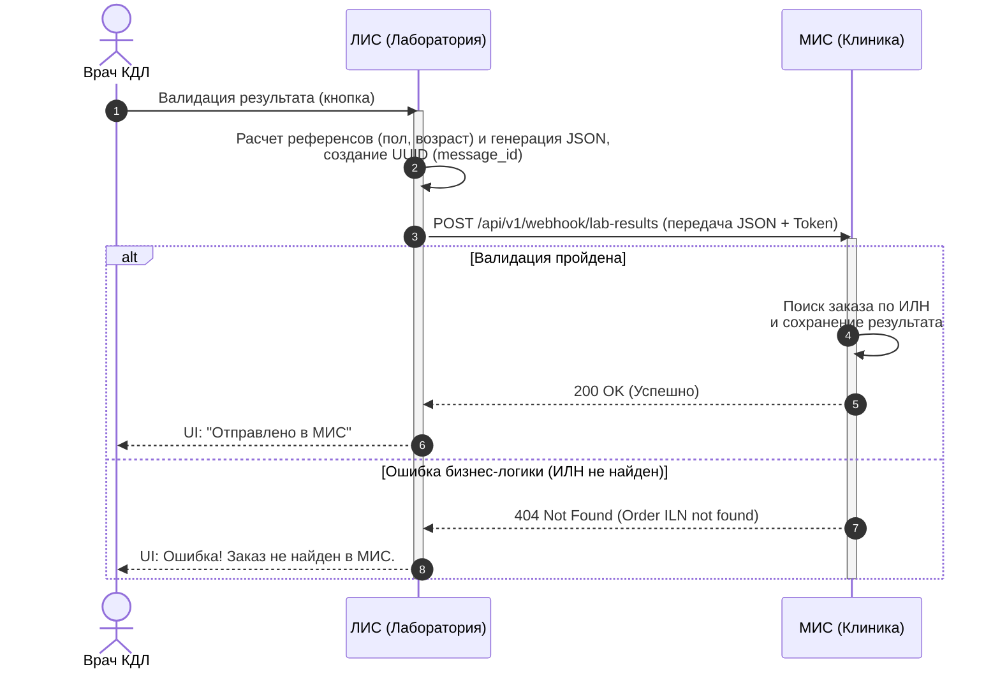
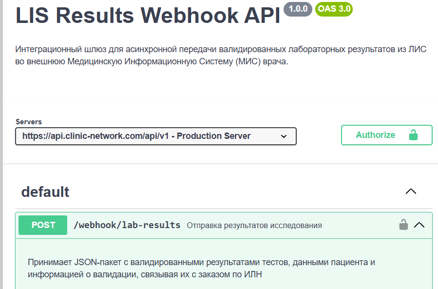
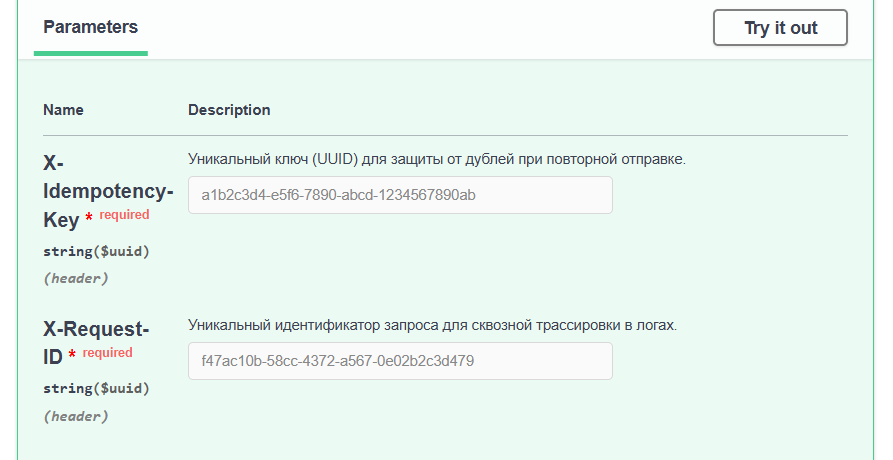
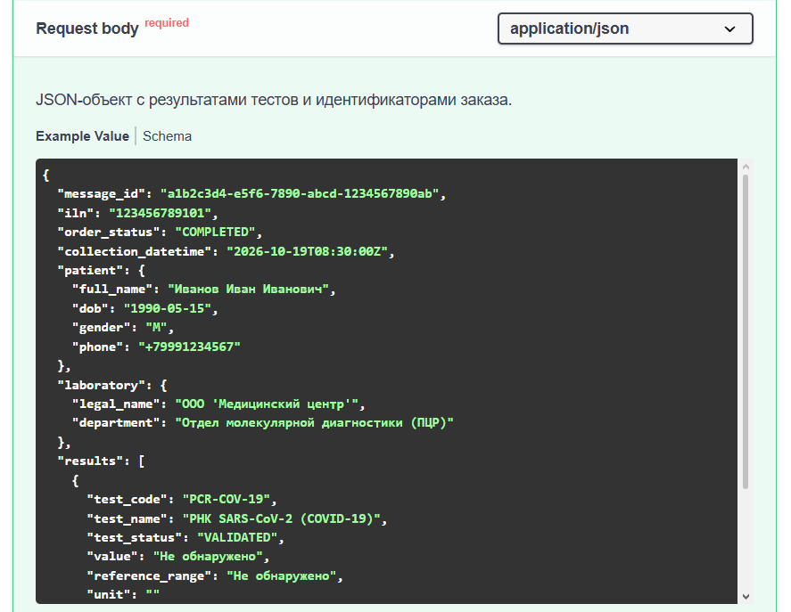
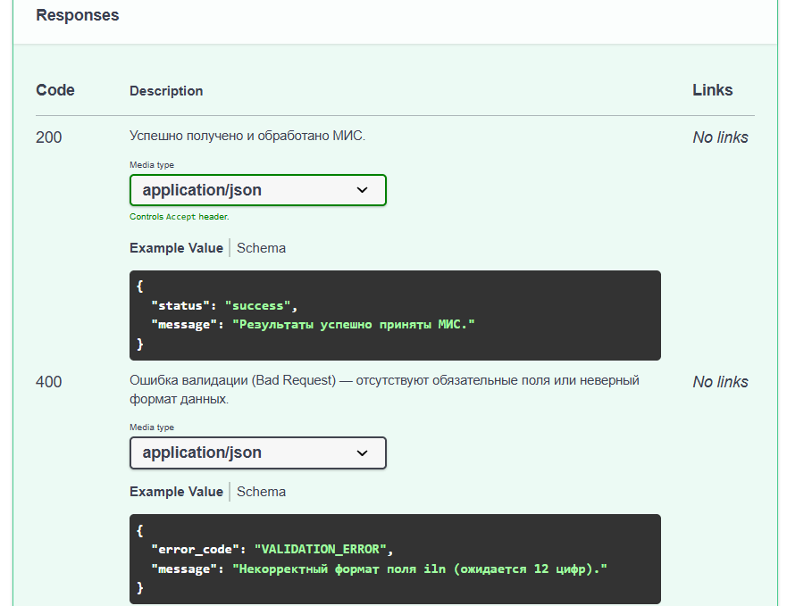
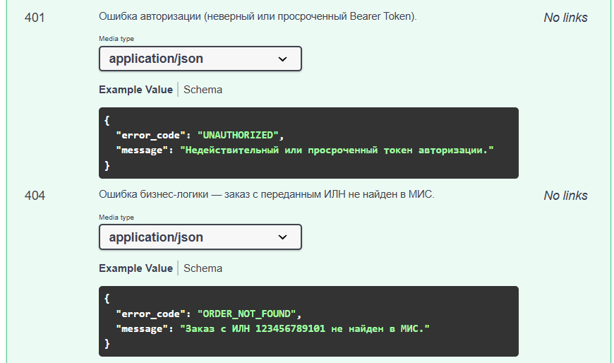
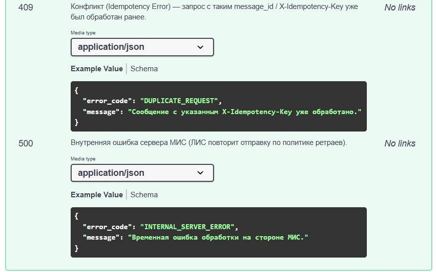

# Спецификация интеграции: Передача результатов (REST API)

**Архитектурный стиль:** REST (Webhook / Push-модель)  
**Триггер отправки:** Валидация результата врачом КДЛ в интерфейсе ЛИС.  
**Целевая система:** Внешняя МИС клиники (формирование и выдача бланка пациенту).  
**Безопасность:** Авторизация по `Bearer Token` (OAuth 2.0 / JWT) + передача в заголовке `X-Request-ID` для трассировки.

## Бизнес-правила
1. **Идентификация и Идемпотентность:** МИС ожидает получить **ИЛН** (12-значный номер заказа), а не рабочий штрихкод физической пробирки. ИЛН является первичным ключом для связи результата с ЭМК пациента. Для исключения дублирования бланков при повторной отправке (например, после разрыва сети) ЛИС передает `message_id` для обеспечения идемпотентности.
2. **Динамические референсы:** Референсные значения рассчитываются на стороне ЛИС в момент постановки теста, опираясь на пол и дату рождения пациента. МИС получает уже готовые текстовые значения нормы.
3. **Юридическая значимость:** Пакет данных в обязательном порядке содержит реквизиты юридического лица лаборатории-исполнителя, а также подпись и ФИО врача КДЛ, выдававшего результат.

---

## Контракт данных
**Endpoint:** `POST /api/v1/webhook/lab-results`  
**Content-Type:** `application/json`
**Headers:**
* `Authorization: Bearer <token>`
* `X-Idempotency-Key: <uuid>`

### Пример тела запроса

```json
{
  "message_id": "a1b2c3d4-e5f6-7890-abcd-1234567890ab",
  "iln": "123456789101",
  "order_status": "COMPLETED",
  "collection_datetime": "2026-10-19T08:30:00Z",
  "patient": {
    "full_name": "Иванов Иван Иванович",
    "dob": "1990-05-15",
    "gender": "M",
    "phone": "+79991234567"
  },
  "laboratory": {
    "legal_name": "ООО 'Медицинский центр'",
    "department": "Отдел молекулярной диагностики (ПЦР)"
  },
  "results": [
    {
      "test_code": "PCR-COV-19",
      "test_name": "РНК SARS-CoV-2 (COVID-19)",
      "test_status": "VALIDATED",
      "value": "Не обнаружено",
      "reference_range": "Не обнаружено",
      "unit": ""
    }
  ],
  "validation": {
    "doctor_full_name": "Смирнова А.В.",
    "validated_datetime": "2026-10-19T14:45:00Z"
  }
}
```
### Коды ответов (Response Codes)

| Код | Описание | Сценарий |
| :--- | :--- | :--- |
| `200 OK` | Success | МИС успешно приняла данные и привязала к ЭМК. |
| `400 Bad Request` | Validation Error | Отсутствуют обязательные поля (например, нет ФИО врача). |
| `401 Unauthorized` | Auth Error | Невалидный или просроченный Bearer Token. |
| `404 Not Found` | Business Error | Заказ с переданным ИЛН не найден в МИС. |
| `409 Conflict` | Idempotency Error | Результаты по данному ИЛН уже были загружены ранее. |
| `500 Internal Error` | Server Error | Внутренняя ошибка на сервере МИС. |

### Описание параметров (Data Dictionary)

| Параметр | Тип | Обязательность | Описание |
| :--- | :--- | :--- | :--- |
| `message_id` | UUID (String) | Да | Уникальный идентификатор сообщения для обеспечения идемпотентности. |
| `iln` | String | Да | Идентификационный Личный Номер заказа. |
| `collection_datetime` | DateTime | Да | Дата и время забора биоматериала (ISO 8601). |
| `patient.gender` | String | Да | Пол пациента (M/F). Исходный параметр для расчета `reference_range`. |
| `results[].value` | String | Да | Фактический результат исследования. |
| `results[].test_status` | String | Да | Статус конкретного теста (например, VALIDATED, REJECTED). |
| `validation.doctor_full_name` | String | Да | ФИО врача КДЛ, проводившего интерпретацию и валидацию. |

## Диаграмма последовательности (Sequence Diagram)


## 📑 Спецификация OpenAPI (Swagger)

Полный контракт API спроектирован по стандарту OpenAPI 3.0. 
📄 **[Смотреть исходный код контракта (api-results-swagger.yaml)](api-results-swagger.yaml)**

### Визуализация контракта (Swagger UI)

**1. Описание эндпоинта и общая информация**


**2. Заголовки запроса (Parameters / Headers)**


**3. Структура тела запроса (Request Body)**


**4. Коды и сценарии ответов (Responses)**



