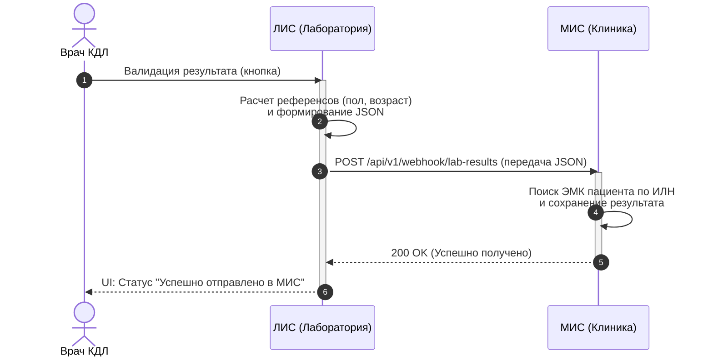

# Спецификация интеграции: Передача результатов (REST API)

**Архитектурный стиль:** REST (Webhook / Push-модель)  
**Триггер отправки:** Валидация результата врачом КДЛ в интерфейсе ЛИС.  
**Целевая система:** Внешняя МИС клиники (формирование и выдача бланка пациенту).  

## Бизнес-правила
1. **Идентификация:** МИС ожидает получить **ИЛН** (12-значный номер заказа), а не рабочий штрихкод физической пробирки (ИНЗ+Код контейнера). ИЛН является первичным ключом для связи результата с финансовым чеком и ЭМК (Электронной медицинской картой) пациента.
2. **Динамические референсы:** Референсные значения рассчитываются на стороне ЛИС в момент постановки теста, опираясь на пол и дату рождения пациента. МИС получает уже готовые текстовые значения нормы.
3. **Юридическая значимость:** Для формирования валидного бланка с ЭЦП, пакет данных в обязательном порядке содержит реквизиты юридического лица лаборатории-исполнителя, а также подпись и ФИО врача КДЛ, подтвердившего результат.

---

## Контракт данных
**Endpoint:** `POST /api/v1/webhook/lab-results`  
**Content-Type:** `application/json`

### Пример тела запроса

```json
{
  "iln": "123456789101",
  "order_status": "COMPLETED",
  "collection_datetime": "2026-10-19T08:30:00Z",
  "patient": {
    "full_name": "Иванов Иван Иванович",
    "birth_date": "1990-05-15",
    "gender": "M",
    "phone": "+79991234567"
  },
  "laboratory": {
    "legal_name": "ООО 'Медицинский центр'",
    "department": "Отдел молекулярной биологии (ПЦР)"
  },
  "results": [
    {
      "test_code": "PCR-COV-19",
      "test_name": "РНК SARS-CoV-2 (COVID-19)",
      "test_status": "VALIDATED",
      "value": "Не обнаружено",
      "reference_range": "Не обнаружено",
      "unit": ""
    }
  ],
  "validation": {
    "doctor_full_name": "Смирнова А.В.",
    "validated_datetime": "2026-10-19T14:45:00Z",
    "head_of_lab_stamp_required": true
  }
}
```

### Описание параметров (Data Dictionary)

| Параметр | Тип | Обязательность | Описание |
| :--- | :--- | :--- | :--- |
| `iln` | String | Да | Идентификационный Личный Номер заказа. |
| `collection_datetime` | DateTime | Да | Дата и время забора биоматериала (ISO 8601). |
| `patient.gender` | String | Да | Пол пациента (M/F). Исходный параметр для расчета `reference_range`. |
| `results[].value` | String | Да | Фактический результат исследования. |
| `results[].test_status` | String | Да | Статус конкретного теста (например, VALIDATED, REJECTED). |
| `validation.doctor_full_name` | String | Да | ФИО врача КДЛ, проводившего интерпретацию и валидацию. |

## Диаграмма последовательности (Sequence Diagram)


