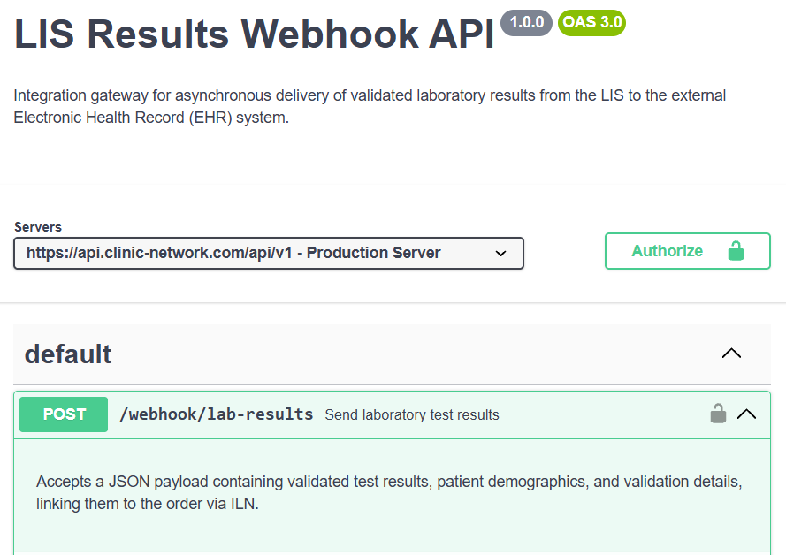
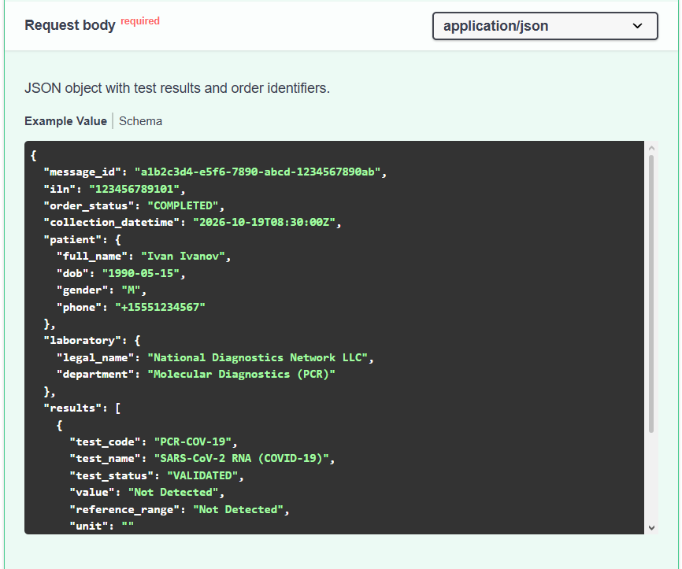
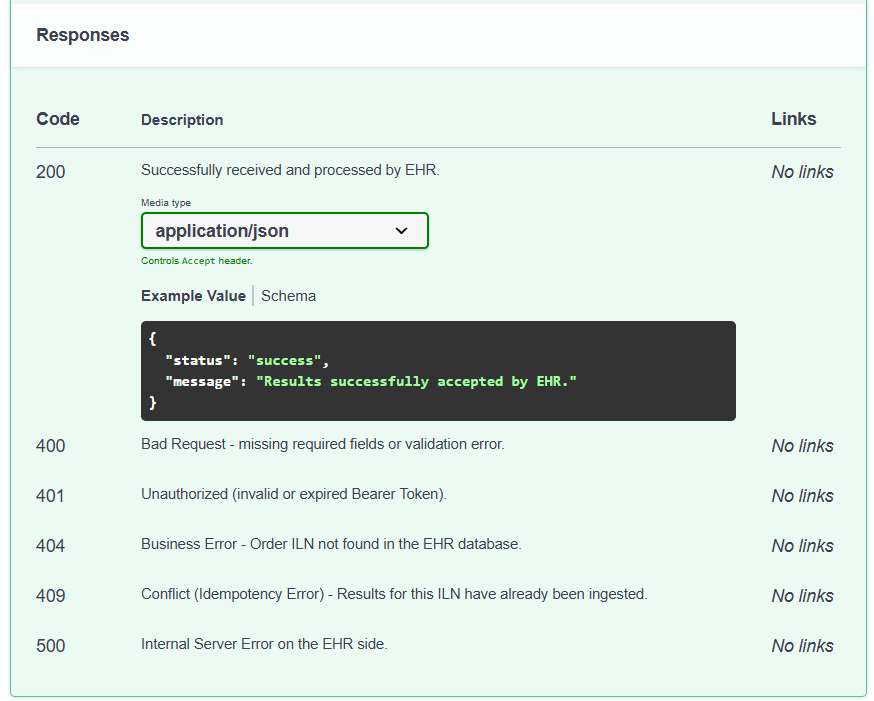

# Integration Specification: Result Delivery (REST API)

**Architectural Style:** REST (Webhook / Push Model)  
**Trigger Event:** Result validation by the Clinical Pathologist in the LIS interface.  
**Target System:** External EHR (Electronic Health Record) system.
**Security:** Authorization via `Bearer Token` (OAuth 2.0 / JWT) + `X-Request-ID` header for distributed tracing.

## Business Rules
1. **Identification & Idempotency:** The EHR expects the **ILN** (12-digit Order Number) rather than the physical specimen barcode. The ILN serves as the primary key linking the result to the patient's EHR profile. To prevent duplicate report generation during retries, the LIS sends a `message_id` ensuring idempotency.
2. **Dynamic Reference Ranges:** Reference ranges are calculated dynamically by the LIS based on the patient's gender and DOB. The EHR receives pre-calculated textual values.
3. **Legal Compliance & E-Signature:** The payload strictly includes the executing laboratory's legal entity details and the authorizing Clinical Pathologist's full name.

---

## Data Contract
**Endpoint:** `POST /api/v1/webhook/lab-results`  
**Content-Type:** `application/json`
**Headers:** 
* `Authorization: Bearer <token>`
* `X-Idempotency-Key: <uuid>`

### Example Request Body

```json
{
  "message_id": "a1b2c3d4-e5f6-7890-abcd-1234567890ab",
  "iln": "123456789101",
  "order_status": "COMPLETED",
  "collection_datetime": "2026-10-19T08:30:00Z",
  "patient": {
    "full_name": "Ivan Ivanov",
    "dob": "1990-05-15",
    "gender": "M",
    "phone": "+15551234567"
  },
  "laboratory": {
    "legal_name": "National Diagnostics Network LLC",
    "department": "Molecular Diagnostics (PCR)"
  },
  "results": [
    {
      "test_code": "PCR-COV-19",
      "test_name": "SARS-CoV-2 RNA (COVID-19)",
      "test_status": "VALIDATED",
      "value": "Not Detected",
      "reference_range": "Not Detected",
      "unit": ""
    }
  ],
  "validation": {
    "doctor_full_name": "Dr. Alice Smith",
    "validated_datetime": "2026-10-19T14:45:00Z"
  }
}
```
### Response Codes

| Code | Description | Scenario |
| :--- | :--- | :--- |
| `200 OK` | Success | EHR successfully received and linked the data. |
| `400 Bad Request` | Validation Error | Missing required fields (e.g., Doctor's Name). |
| `401 Unauthorized` | Auth Error | Invalid or expired Bearer Token. |
| `404 Not Found` | Business Error | Order ILN not found in the EHR database. |
| `409 Conflict` | Idempotency Error | Results for this ILN have already been ingested. |
| `500 Internal Error` | Server Error | Internal Server Error on the EHR side. |

### Data Dictionary

| Parameter | Type | Required | Description |
| :--- | :--- | :--- | :--- |
| `message_id` | UUID (String) | Yes | Unique message identifier to ensure idempotency. |
| `iln` | String | Yes | Identification Personal Number (Order Number). |
| `collection_datetime` | DateTime | Yes | Actual date and time of specimen collection (ISO 8601). |
| `patient.gender` | String | Yes | Patient's gender (M/F). Critical for defining the `reference_range`. |
| `results[].value` | String | Yes | The actual test result value. |
| `results[].test_status` | String | Yes | Status of the specific test (e.g., VALIDATED, REJECTED). |
| `validation.doctor_full_name` | String | Yes | Full name of the Clinical Pathologist who interpreted and validated the result. |

## Sequence Diagram

```mermaid
sequenceDiagram
    autonumber
    actor Doctor as Clinical Pathologist
    participant LIS as LIS (Laboratory)
    participant EHR as EHR (Clinic)

    Doctor->>LIS: Validate result (button click)
    activate LIS
    LIS->>LIS: Calculate reference ranges,<br/>generate UUID (message_id)
    LIS->>EHR: POST /api/v1/webhook/lab-results (JSON + Token)
    activate EHR
    EHR->>EHR: Lookup patient profile by ILN<br/>and save result
    EHR-->>LIS: 200 OK (Successfully received)
    LIS-->>Doctor: UI: "Successfully sent to EHR"
    else Business Error (ILN Not Found)
        EHR-->>LIS: 404 Not Found (Order ILN not found)
        LIS-->>Doctor: UI: Error! Order not found in EHR.
    end
    deactivate EHR
    deactivate LIS
```

## 📑 OpenAPI (Swagger) Specification

The complete API contract is designed according to the OpenAPI 3.0 standard. 
📄 **[View the source contract code (api-results-swagger_en.yaml)](api-results-swagger_en.yaml)**

### Contract Visualization (Swagger UI)

**1. Endpoint Description and Overview**


**2. Request Body Structure**


**3. Response Codes and Scenarios**

