## Бизнес-процесс As-Is (До внедрения новой ЛИС)

```mermaid
flowchart LR
    classDef risk fill:#ffe6e6,stroke:#ff0000,stroke-width:2px,color:#000000;

    subgraph "Внешний контур (Клиника и Курьер)"
        A((Старт)) --> B[Оформление в МИС, забор БМ]
        B --> B1[Печать бланка для подписи пациента<br/>Бланк остается в клинике]
        B1 --> C[Курьер везет термосумку с БМ<br/>Электронная накладная]
        C -.-> R1[Риск: Утеря сумки, нарушение температуры]
        class R1 risk
    end

    subgraph "Регистратура (Сортировка)"
        C --> D[Прием сумок, распаковка]
        D --> E[Сканирование ИНЗ в ЛИС]
        E --> F[Ручная сортировка в штативы по отделам<br/>Опора на цвет крышки]
        F -.-> R2[Риск: Человеческий фактор,<br/>пробирка не в том штативе]
        class R2 risk
    end

    subgraph "ПЦР-отдел (Чистая зона)"
        F --> G[Прием штатива, сортировка по<br/>кодам и типу выделения]
        G --> H[Сканирование во внутреннее ПО<br/>Создание вторичного номера]
        H --> I[Предподготовка БМ<br/>Центрифугирование, химобработка]
        I --> J{Сценарий раскапки}
        
        J -->|Автомат| K[Установка БМ в прибор<br/>Автоматическая раскапка]
        K -.-> R3[Риск: Сдвиг лунки при установке]
        class R3 risk
        
        J -->|Полуавтомат/Ручной| L[Экстракция в приборе или вручную<br/>Раскапка за световыми столиками]
        L --> M[Двойной контроль: сканирование<br/>плашек перед раскапкой]
        
        K --> N[Закрытие плашки]
        M --> N
        N -.-> R4[Риск: Кросс-контаминация,<br/>сторонняя грязь]
        class R4 risk
    end

    subgraph "ПЦР-отдел (Грязная зона)"
        N --> O[Постановка плашки в амплификатор<br/>Ожидание завершения программы]
        O --> P[Автовыгрузка результатов<br/>во внутреннее ПО]
        P --> Q[Сверка данных: ЛИС + внутреннее ПО<br/>Оценка графиков и контролей]
        Q -.-> R5[Риск: Пропуск смены контролей,<br/>ошибка чтения пиков]
        class R5 risk
        Q --> S[Врач вручную переносит решение<br/>из внутреннего ПО в ЛИС]
        S -.-> R6[Риск: Ошибка ручного переноса]
        class R6 risk
        S --> End((Готово))
    end
```

### Текстовая структура бизнес-процесса "As-Is" (До внедрения новой ЛИС)

**1. Зона: Процедурный кабинет и Курьер (Внешний контур)**
* **Действие 1:** Регистрация пациента, забор биоматериала (БМ), печать бумажного бланка (направления).
* **Действие 2:** Курьер забирает сумку-холодильник с накладными и везет в лабораторию.
* **⚠️ Риски (Узкие места):** Ошибки при регистрации (однофамильцы, неверные тесты), нарушение температурного режима в пути (критично для СМЖ), утеря сумки или доставка не по адресу.

**2. Зона: Регистратура лаборатории (Сортировка)**
* **Действие 1:** Распаковка сумок, приоритизация (срочные сроки/дальние города), сверка с накладной.
* **Действие 2:** Сканирование первичного штрихкода (ИНЗ) в ЛИС.
* **Действие 3 (Ручное):** Сортировка пробирок в штативы по отделам. Регистратор опирается на бумажный бланк и цвет крышки пробирки.
* **⚠️ Риски:** Потеря бланка, потеря пробирки, человеческий фактор — регистратор положил пробирку не в тот штатив (перепутал отдел).

**3. Зона: ПЦР-отдел — Лаборант (Чистая зона / Экстракция и Раскапка)**
* **Действие 1:** Лаборант забирает штативы из регистратуры. Внутри отдела идет дополнительная ручная сортировка по типу выделения (автомат/ручное) на основе кодов и цвета крышки.
* **Действие 2 (Двойная работа):** Лаборант сканирует ИНЗ во внутреннюю программу («Аналитическое ПО»). Программа присваивает пробирке вторичный (внутренний) номер. ФИО пациента в этой программе нет (только на самой пробирке).
* **Действие 3 (Предподготовка БМ):** Центрифугирование, а также внесение специфических реагентов для химической обработки, если того строго требует методика подготовки конкретного типа биоматериала.
* **Действие 4 (Экстракция и Раскапка):** Строго соблюдается этапность: сначала выделение БМ (экстракция), затем раскапка выделенного БМ в плашки с сухим реагентом. Возможны три сценария:
  * *Сценарий А (Автоматический метод):* Лаборант загружает весь БМ, реагенты и пластик в станцию-анализатор и запускает процесс. Прибор полностью автоматически выделяет БМ и раскапывает его в целевые плашки.
  * *Сценарий Б (Полуавтоматический метод):* Лаборант ставит в прибор пустой планшет, реагенты и исходный БМ. После автоматического выделения, лаборант забирает планшет и вручную раскапывает БМ в плашки с сухим реагентом, используя световые столики.
  * *Сценарий В (Ручной метод):* Образцы проводятся через ПО-сортер. Экстракция делается лаборантом вручную (либо ручная раскапка в планшет и выделение в приборе). Далее лаборант вручную раскапывает экстрагированный БМ за световыми столиками.
* **Действие 5 (Двойной контроль раскапки):** При работе за световыми столиках (сценарии Б и В) лаборант обязательно сканирует штрихкод каждой плашки с реагентами перед раскапкой.
* **Действие 6:** Лаборант плотно закрывает плашку для передачи в "грязную" зону.
* **⚠️ Риски:** Кросс-контаминация образцов, контаминация сторонней грязью. При автоматической раскапке «замыливается глаз» на этапе установки пробирок в штатив. Подобраны некорректные реагенты.

**4. Зона: ПЦР-отдел — Врач КДЛ (Грязная зона / Амплификация и Валидация)**
* **Действие 1:** Врач ставит закрытую плашку в амплификатор, сканирует штрихкод плашки — подгружается программа с нужной температурой плавления. Запускается амплификация.
* **Действие 2:** После завершения амплификации результаты (графики) автоматически выгружаются в «Аналитическое ПО».
* **Действие 3 (Сложная сверка):** Врач начинает валидацию. Открывает ЛИС (возраст, пол, история) и «Аналитическое ПО» (проверяет сроки годности/серии наборов, оценивает графики плавления, пики и контроли).
* **Действие 4:** Если результат устраивает, врач вручную переносит решение («Обнаружено / Не обнаружено») из Аналитического ПО в ЛИС, формируя бланк с подписью.
* **⚠️ Риски:** Врач может пропустить информацию о смене серии контролей/реагентов, некорректно считать пики на кривой из-за нехватки опыта или по невнимательности совершить ошибку при ручном переносе результата.
  
  
## Бизнес-процесс To-Be (Оптимизированный процесс)

```mermaid
flowchart LR
    classDef automation fill:#e6ffe6,stroke:#00aa00,stroke-width:2px,color:#000000;

    subgraph "Внешний контур (Клиника и Курьер)"
        A((Старт)) --> B[Оформление в МИС без бумажных бланков<br/>Печать ИНЗ на пробирку]
        B --> C[Доставка БМ курьером]
    end

    subgraph "Регистратура (Сортировка)"
        C --> D[Распаковка сумок]
        D --> E[Сканирование ИНЗ в ЛИС<br/>Открытие цифрового двойника бланка]
        E --> F[Автоматизированная сортировка<br/>Индикация Put-to-Light над штативом]
        class F automation
    end

    subgraph "ПЦР-отдел (Чистая зона)"
        F --> G[Сканирование штатива при приемке]
        G --> H[ПО запрашивает данные у ЛИС по API<br/>Без создания вторичных номеров]
        class H automation
        H --> I[Предподготовка БМ]
        I --> J[Умная раскапка по схеме от ЛИС<br/>Контроль сортером и столиками]
        J --> K[Закрытие плашки для передачи]
    end

    subgraph "ПЦР-отдел (Грязная зона)"
        K --> L[Постановка плашки в амплификатор<br/>Запуск программы]
        L --> M[Выгрузка результатов<br/>во внутреннее ПО]
        M --> N[Сверка данных: ЛИС + внутреннее ПО]
        N --> O[Валидация одной кнопкой<br/>Автопередача результата по API в ЛИС]
        class O automation
        O --> P[Автоформирование бланка в ЛИС<br/>Отправка пациенту и в личный кабинет]
        P --> End((Готово))
    end
```

### Текстовая структура бизнес-процесса "To-Be" (После внедрения ЛИС и интеграции)

**1. Зона: Процедурный кабинет и Курьер (Внешний контур)**
* **Действие 1:** Оформление заказа в МИС. Печать бумажного бланка заказа исключительно для сверки данных и подписи пациента (бумага остается в клинике). На пробирку клеится штрихкод (ИНЗ).
* **Действие 2:** Курьер доставляет термосумку с БМ. Накладная передается электронно в виде штрихкода реестра.
* **✔️ Устраненный риск:** Нет риска потерять бумажное направление, отправить пробирку без опознавательных знаков или неверно прочитать почерк.

**2. Зона: Регистратура лаборатории (Сортировка)**
* **Действие 1:** Распаковка сумок.
* **Действие 2 (Цифровой бланк):** Регистратор сканирует ИНЗ. На экране ЛИС открывается полная электронная карточка заказа (ФИО, тесты, комментарии клиники). Все спорные случаи клиника фиксирует в системе, и лаборатория видит их на экране в режиме реального времени.
* **Действие 3 (Автоматизированная сортировка):** ЛИС автоматически зажигает лампочку над целевым штативом (Put-to-Light) для сортировки.
* **✔️ Устраненный риск:** Регистратору больше не нужно принимать решения на основе цвета крышки и помнить маршруты. Риск положить пробирку не в тот отдел сведен к нулю.

**3. Зона: ПЦР-отдел — Лаборант (Чистая зона / Экстракция и Раскапка)**
* **Действие 1:** Лаборант сканирует штатив при приемке в отдел.
* **Действие 2 (Бесшовная интеграция):** При сканировании ИНЗ Аналитическое ПО автоматически запрашивает данные у ЛИС по API. Вторичные внутренние номера больше не создаются. Программа сразу «знает», какие тесты нужны этому ИНЗ.
* **Действие 3:** Предподготовка БМ (центрифугирование, химобработка).
* **Действие 4 (Умная раскапка):** ЛИС/Аналитическое ПО автоматически генерирует схему виртуального штатива и планшета. Процесс экстракции и раскапки идет по выбранному сценарию. Сортер и световые столики контролируют каждое движение.
* **Действие 5:** Лаборант плотно закрывает плашку для передачи в "грязную" зону.
* **✔️ Устраненный риск:** Исключена двойная регистрация БМ. Снижена когнитивная нагрузка на лаборанта при расчете лунок.

**4. Зона: ПЦР-отдел — Врач КДЛ (Грязная зона / Амплификация и Валидация)**
* **Действие 1:** Врач ставит закрытую плашку в амплификатор, сканирует штрихкод. Запускается нужная программа.
* **Действие 2:** Результаты амплификации выгружаются во внутреннюю программу («Аналитическое ПО»), где врач проводит процесс валидации.
* **Действие 3 (Сверка данных):** Врач открывает Аналитическое ПО для оценки результата (графики, пики, контроли) и параллельно использует ЛИС как дополнительный источник информации о пациенте (история исследований, возраст).
* **Действие 4 (Автоматизированная отправка):** Если результат корректен (хорошо читается, не требует перестановки), врач нажимает кнопку отправки во внутренней программе. Результат автоматически передается по API в ЛИС и жестко связывается с карточкой пациента по связке ИНЗ-ИЛН.
* **Действие 5 (Выдача результата):** ЛИС автоматически формирует бланк с результатом. Бланк отправляется пациенту на email, сохраняется в виртуальном личном кабинете или выдается в распечатанном виде при личном обращении в медицинский офис.
* **✔️ Устраненный риск:** Исключен ручной текстовый перенос статуса «Обнаружено/Не обнаружено». Передача данных в ЛИС по нажатию одной кнопки исключает риск опечатки.

## Заключение: Бизнес-ценность внедрения (Business Value)

Трансформация процесса из модели **As-Is** в **To-Be** решает ключевые операционные проблемы клинико-диагностической лаборатории:

1. **Минимизация человеческого фактора (Zero Tolerance to Error):** Полностью исключена ручная сортировка пробирок по цвету крышек, двойной ручной ввод данных и текстовый перенос результатов валидации.
2. **Бесшовная интеграция данных:** Связка ЛИС и Аналитического ПО по API ликвидирует потребность во вторичных (внутренних) номерах. Система сама управляет маршрутизацией биоматериала.
3. **Единое окно врача (Single Window Workstation):** Врач КДЛ получает всю необходимую информацию для валидации (анамнез пациента из ЛИС + графики плавления и контроли из Аналитического ПО) в едином интерфейсе. Это кратно сокращает время выдачи результатов (TAT — Turnaround Time).
4. **Прослеживаемость (Traceability):** Отказ от бумажных маршрутных листов в пользу цифрового двойника бланка и аппаратного контроля (Put-to-Light, сортеры) обеспечивает 100% прозрачность перемещения биоматериала на каждом этапе.
