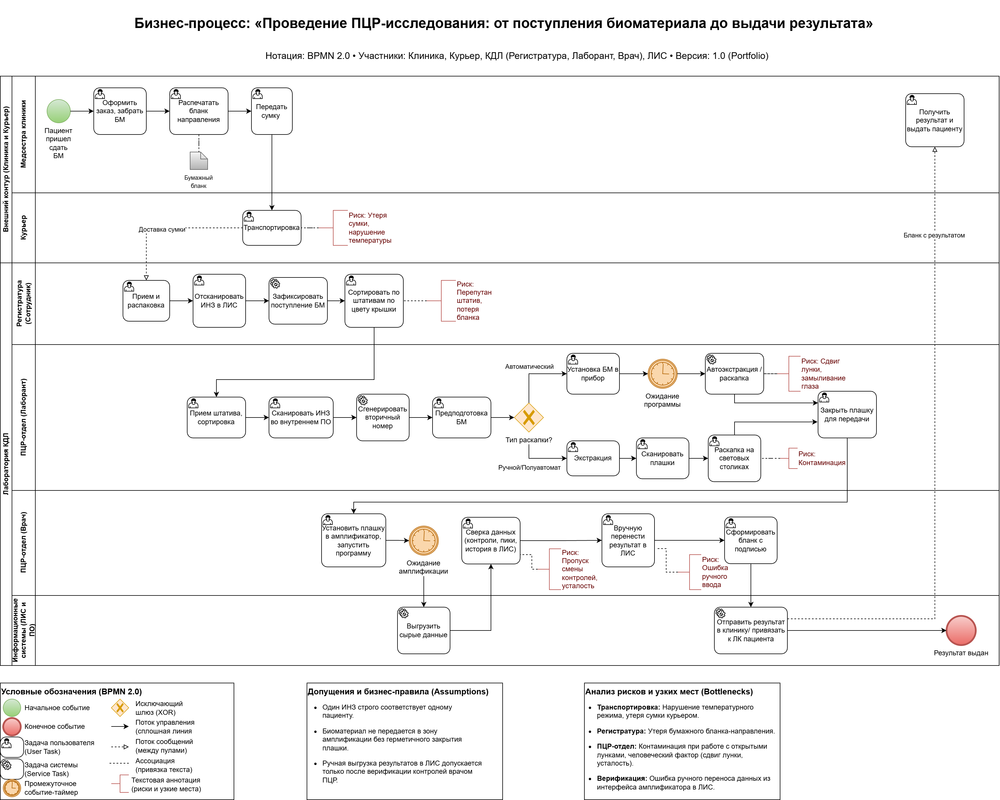
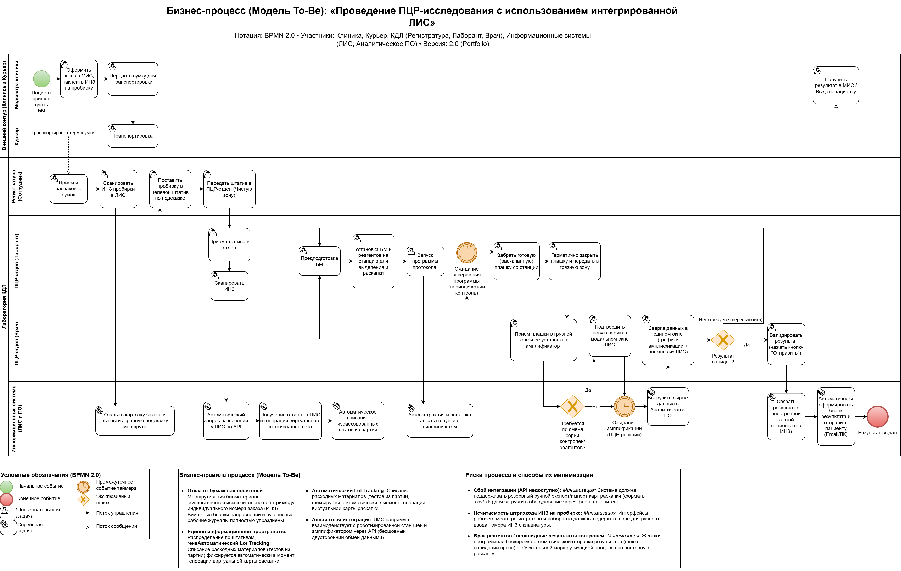

## Бизнес-процесс As-Is (До внедрения новой ЛИС)
  
📄 [Скачать схему в высоком разрешении (PDF)](pcr-process-as-is.pdf)

### Текстовая структура бизнес-процесса "As-Is" (До внедрения новой ЛИС)

**1. Зона: Процедурный кабинет и Курьер (Внешний контур)**
* **Действие 1:** Регистрация пациента, забор биоматериала (БМ), печать бумажного бланка (направления).
* **Действие 2:** Курьер забирает сумку-холодильник с накладными и везет в лабораторию.
* **⚠️ Риски (Узкие места):** Ошибки при регистрации (однофамильцы, неверные тесты), нарушение температурного режима в пути (критично для СМЖ), утеря сумки или доставка не по адресу.

**2. Зона: Регистратура лаборатории (Сортировка)**
* **Действие 1:** Распаковка сумок, приоритизация (срочные сроки/дальние города), сверка с накладной.
* **Действие 2:** Сканирование первичного штрихкода (ИНЗ) в ЛИС.
* **Действие 3 (Ручное):** Сортировка пробирок в штативы по отделам. Регистратор опирается на бумажный бланк и цвет крышки пробирки.
* **⚠️ Риски:** Потеря бланка, потеря пробирки, человеческий фактор — регистратор положил пробирку не в тот штатив (перепутал отдел).

**3. Зона: ПЦР-отдел — Лаборант (Чистая зона / Экстракция и Раскапка)**
* **Действие 1:** Лаборант забирает штативы из регистратуры. Внутри отдела идет дополнительная ручная сортировка по типу выделения (автомат/ручное) на основе кодов и цвета крышки.
* **Действие 2 (Двойная работа):** Лаборант сканирует ИНЗ во внутреннюю программу («Аналитическое ПО»). Программа присваивает пробирке вторичный (внутренний) номер. ФИО пациента в этой программе нет (только на самой пробирке).
* **Действие 3 (Предподготовка БМ):** Центрифугирование, а также внесение специфических реагентов для химической обработки, если того строго требует методика подготовки конкретного типа биоматериала.
* **Действие 4 (Экстракция и Раскапка):** Строго соблюдается этапность: сначала выделение БМ (экстракция), затем раскапка выделенного БМ в плашки с сухим реагентом. Возможны три сценария:
  * *Сценарий А (Автоматический метод):* Лаборант загружает весь БМ, реагенты и пластик в станцию-анализатор и запускает процесс. Прибор полностью автоматически выделяет БМ и раскапывает его в целевые плашки.
  * *Сценарий Б (Полуавтоматический метод):* Лаборант ставит в прибор пустой планшет, реагенты и исходный БМ. После автоматического выделения, лаборант забирает планшет и вручную раскапывает БМ в плашки с сухим реагентом, используя световые столики.
  * *Сценарий В (Ручной метод):* Образцы проводятся через ПО-сортер. Экстракция делается лаборантом вручную (либо ручная раскапка в планшет и выделение в приборе). Далее лаборант вручную раскапывает экстрагированный БМ за световыми столиками.
* **Действие 5 (Двойной контроль раскапки):** При работе за световыми столиках (сценарии Б и В) лаборант обязательно сканирует штрихкод каждой плашки с реагентами перед раскапкой.
* **Действие 6:** Лаборант плотно закрывает плашку для передачи в "грязную" зону.
* **⚠️ Риски:** Кросс-контаминация образцов, контаминация сторонней грязью. При автоматической раскапке «замыливается глаз» на этапе установки пробирок в штатив. Подобраны некорректные реагенты.

**4. Зона: ПЦР-отдел — Врач КДЛ (Грязная зона / Амплификация и Валидация)**
* **Действие 1:** Врач ставит закрытую плашку в амплификатор, сканирует штрихкод плашки — подгружается программа с нужной температурой плавления. Запускается амплификация.
* **Действие 2:** После завершения амплификации результаты (графики) автоматически выгружаются в «Аналитическое ПО».
* **Действие 3 (Сложная сверка):** Врач начинает валидацию. Открывает ЛИС (возраст, пол, история) и «Аналитическое ПО» (проверяет сроки годности/серии наборов, оценивает графики плавления, пики и контроли).
* **Действие 4:** Если результат устраивает, врач вручную переносит решение («Обнаружено / Не обнаружено») из Аналитического ПО в ЛИС, формируя бланк с подписью.
* **⚠️ Риски:** Врач может пропустить информацию о смене серии контролей/реагентов, некорректно считать пики на кривой из-за нехватки опыта или по невнимательности совершить ошибку при ручном переносе результата.
  
  
## Бизнес-процесс To-Be (Оптимизированный процесс)

📄 [Скачать схему в высоком разрешении (PDF)](pcr-process-to-be.pdf)

### Текстовая структура бизнес-процесса "To-Be" (После внедрения ЛИС и интеграции)

**1. Зона: Процедурный кабинет и Курьер (Внешний контур)**
* **Действие 1:** Оформление заказа в МИС. Печать бумажного бланка заказа исключительно для сверки данных и подписи пациента (бумага остается в клинике). На пробирку клеится штрихкод (ИНЗ).
* **Действие 2:** Курьер доставляет термосумку с БМ. Накладная передается электронно в виде штрихкода реестра.
* **✔️ Устраненный риск:** Нет риска потерять бумажное направление, отправить пробирку без опознавательных знаков или неверно прочитать почерк.

**2. Зона: Регистратура лаборатории (Сортировка)**
* **Действие 1:** Распаковка сумок.
* **Действие 2 (Цифровой бланк):** Регистратор сканирует ИНЗ. На экране ЛИС открывается полная электронная карточка заказа (ФИО, тесты, комментарии клиники). Все спорные случаи клиника фиксирует в системе, и лаборатория видит их на экране в режиме реального времени.
* **Действие 3 (Экранная маршрутизация):** При сканировании ИНЗ система ЛИС мгновенно выводит на монитор крупную цветовую/текстовую подсказку (например, большое окно «ПЦР — КРАСНЫЙ ШТАТИВ»). Регистратор просто кладет пробирку в указанный штатив, ориентируясь исключительно на экранную подсказку, без необходимости вспоминать сложные правила маршрутизации.
* ✔️ **Устраненный риск:** Снижена когнитивная нагрузка на регистратора. Устранен риск ошибки маршрутизации («человеческий фактор»), так как логика распределения зашита под капотом ЛИС. Риск потери бланка устранен полностью.

**3. Зона: ПЦР-отдел — Лаборант (Чистая зона / Экстракция и Раскапка)**
*   **Действие 1:** Лаборант сканирует ИНЗ при приемке штатива в отдел.
*   **Действие 2 (Бесшовная интеграция):** При сканировании ИНЗ Информационная система открывает карточку заказа и выводит экранную подсказку маршрута, автоматически запрашивая данные у ЛИС по API. Вторичные внутренние номера больше не создаются. Программа сразу «знает», какие тесты нужны этому ИНЗ.
*   **Действие 3 (Автоматический Lot Tracking и Умная раскапка):** Получив ответ от ЛИС, система генерирует виртуальный штатив/планшет. В этот же момент происходит **автоматическое списание израсходованных тестов из текущей партии**. Лаборант проводит предподготовку БМ (центрифугирование, химобработка).
*   **Действие 4:** Лаборант устанавливает БМ и реагенты на станцию для выделения и раскапки, и запускает программу протокола. Процесс автоэкстракции и раскапки элюата в лунки с лиофилизатом идет по выбранному сценарию под контролем системы.
*   **Действие 5:** После автоматического завершения программы (окончания таймера периодического контроля) лаборант забирает готовую плашку со станции и герметично закрывает ее для передачи в "грязную" зону.
*   **✔️ Устраненные риски:** Исключена двойная регистрация БМ. Снижена когнитивная нагрузка на лаборанта при расчете лунок. Человеческий фактор исключен из процесса подсчета остатков реагентов, так как списание происходит автоматически при формировании планшета.

**4. Зона: ПЦР-отдел — Врач КДЛ (Грязная зона / Амплификация и Валидация)**
*   **Действие 1:** Врач принимает плашку в грязной зоне, устанавливает в амплификатор, сканируя ее штрихкод. Запускается нужная программа.
*   **Действие 2 (Контроль партий реагентов):** Система проверяет, требуется ли смена серии контролей или реагентов (на основе данных о расходе, зафиксированных на этапе лаборанта). Если лимит тестов исчерпан, ЛИС выводит врачу модальное окно для обязательного подтверждения новой серии. Врач подтверждает новую серию, после чего запускается таймер ожидания ПЦР-реакции.
*   **Действие 3:** После завершения амплификации сырые данные автоматически выгружаются во внутреннее Аналитическое ПО.
*   **Действие 4 (Сверка данных в едином окне):** Врач проводит процесс валидации, оценивая результат (графики, пики, контроли) и параллельно используя анамнез из ЛИС как дополнительный источник информации о пациенте.
*   **Действие 5 (Цикл валидации и Автоматизированная отправка):** Врач принимает решение в шлюзе валидации:
    *   *Если результат не валиден* (не прошли контроли), процесс по ветке «Нет (требуется перестановка)» возвращается обратно в чистую зону к лаборанту на этап предподготовки БМ.
    *   *Если результат корректен* (хорошо читается), врач нажимает кнопку "Отправить". Результат автоматически связывается с электронной картой пациента (по ИНЗ) во внутренней системе.
*   **Действие 6 (Выдача результата):** ЛИС автоматически формирует бланк с результатом. Бланк отправляется пациенту на email, в виртуальный личный кабинет (ЛК) или выдается в распечатанном виде при личном обращении.
*   **✔️ Устраненные риски:** Исключен ручной текстовый перенос статуса «Обнаружено/Не обнаружено». Передача данных в ЛИС по нажатию одной кнопки исключает риск опечатки. Исключен риск проведения валидации с неактуальными паспортными данными контролей (система не даст врачу забыть про подтверждение смены партии реагентов).

### Заключение: Бизнес-ценность внедрения (Business Value)

Трансформация процесса из модели As-Is в To-Be решает ключевые операционные проблемы клинико-диагностической лаборатории:

1. **Минимизация человеческого фактора (Zero Tolerance to Error):** Полностью исключена ручная маршрутизация пробирок по цвету крышек "по памяти", двойной ручной ввод данных и текстовый перенос результатов валидации.
2. **Бесшовная интеграция данных:** Связка ЛИС и Аналитического ПО по API ликвидирует потребность во вторичных (внутренних) номерах. Система сама управляет маршрутизацией биоматериала.
3. **Единое окно врача (Single Window Workstation):** Врач КДЛ получает всю необходимую информацию для валидации (анамнез пациента из ЛИС + графики плавления и контроли из Аналитического ПО) в едином интерфейсе. Это кратно сокращает время выдачи результатов (TAT — Turnaround Time).
4. **Прослеживаемость (Traceability):** Отказ от бумажных маршрутных листов в пользу цифрового двойника бланка и программной маршрутизации (экранные подсказки ЛИС, автоматические сортеры) обеспечивает 100% прозрачность перемещения биоматериала на каждом этапе.
5. **Автоматизированный контроль качества (Quality Assurance & Compliance):** Проактивное отслеживание партий реагентов и автоматический расчет расхода тестов страхуют лабораторию от выдачи невалидных результатов. Система снимает с врача когнитивную нагрузку по учету контролей и предотвращает ошибку до ее совершения.
