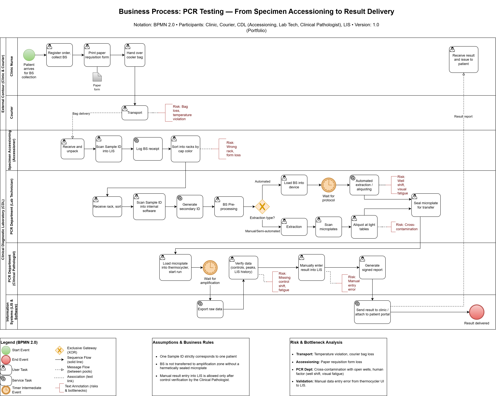
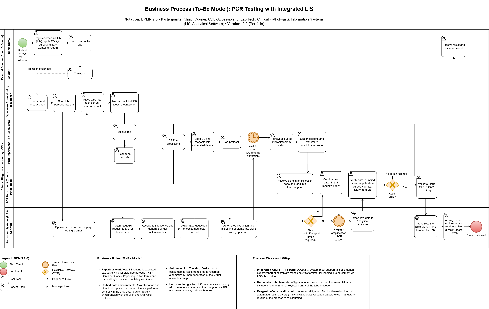

## Business Process As-Is (Prior to New LIS Implementation)

  
📄 [Download high-resolution schema (PDF)](assets/pcr-process-as-is-en.pdf)

### Text Structure of the "As-Is" Business Process (Prior to New LIS Implementation)

**1. Zone: Collection Site and Courier (External Contour)**
* **Action 1:** Patient registration, biological specimen (BS) collection, printing of the paper requisition form.
* **Action 2:** Courier picks up the cooler bag with manifests and transports it to the laboratory.
* **⚠️ Risks (Bottlenecks):** Registration errors (namesakes, incorrect tests), temperature violations during transit (critical for CSF), loss of the bag or delivery to the wrong address.

**2. Zone: Laboratory Reception (Specimen Accessioning)**
* **Action 1:** Unpacking bags, prioritization (urgent/distant cities), reconciliation with the manifest.
* **Action 2:** Scanning the primary barcode (INZ / Sample ID) into the LIS.
* **Action 3 (Manual):** Sorting tubes into racks by department. The accessioner relies on the paper form and the color of the tube cap.
* **⚠️ Risks:** Loss of the form, loss of the tube, human factor — accessioner placed the tube in the wrong rack (mixed up departments).

**3. Zone: PCR Department — Lab Technician (Clean Zone / Extraction and Aliquoting)**
* **Action 1:** Lab technician retrieves the racks from accessioning. Inside the department, an additional manual sorting by extraction type (automated/manual) is performed based on codes and cap color.
* **Action 2 (Double work):** Lab technician scans the INZ into the internal program ("Analytical Software"). The program assigns a secondary (internal) number to the tube. The patient's full name is not in this program (only on the tube itself).
* **Action 3 (BS Pre-processing):** Centrifugation, as well as the addition of specific reagents for chemical treatment, if strictly required by the preparation methodology for a specific type of biological specimen.
* **Action 4 (Extraction and Aliquoting):** Staging is strictly observed: first BS isolation (extraction), then aliquoting the isolated BS into microplates with dry reagent. Three scenarios are possible:
  * *Scenario A (Automated method):* Lab technician loads all BS, reagents, and plastics into the analyzer station and starts the process. The device fully automatically extracts the BS and aliquots it into the target microplates.
  * *Scenario B (Semi-automated method):* Lab technician places an empty microplate, reagents, and the initial BS into the device. After automated extraction, the lab technician takes the microplate and manually aliquots the BS into microplates with dry reagent using light tables.
  * *Scenario C (Manual method):* Samples are passed through the sorter software. Extraction is done by the lab technician manually (or manual aliquoting into a microplate followed by extraction in the device). Next, the lab technician manually aliquots the extracted BS at the light tables.
* **Action 5 (Double check of aliquoting):** When working at the light tables (scenarios B and C), the lab technician must scan the barcode of each microplate with reagents before aliquoting.
* **Action 6:** Lab technician tightly seals the microplate for transfer to the "dirty" zone.
* **⚠️ Risks:** Cross-contamination of samples, contamination with foreign DNA. During automated aliquoting, "visual fatigue" occurs at the stage of placing tubes in the rack. Incorrect reagents selected.

**4. Zone: PCR Department — Clinical Pathologist (Dirty Zone / Amplification and Validation)**
* **Action 1:** The Clinical Pathologist places the sealed microplate into the thermocycler and scans the microplate barcode — the program with the required melting temperature is loaded. Amplification is initiated.
* **Action 2:** After amplification is complete, the results (graphs) are automatically exported to the "Analytical Software".
* **Action 3 (Complex verification):** The Clinical Pathologist begins validation. Opens the LIS (age, gender, history) and the "Analytical Software" (checks expiration dates/batches of kits, evaluates melting curves, peaks, and controls).
* **Action 4:** If the result is satisfactory, the Clinical Pathologist manually transfers the decision ("Detected / Not Detected") from the Analytical Software to the LIS, generating a signed report.
* **⚠️ Risks:** The Clinical Pathologist may miss information about a change in the batch of controls/reagents, incorrectly interpret peaks on the curve due to lack of experience, or carelessly make an error during the manual transfer of the result.

## Business Process To-Be (Optimized Process)

📄 [Download high-resolution schema (PDF)](assets/pcr-process-to-be_en.pdf)

### Text Structure of the "To-Be" Business Process (Post-LIS Implementation & Integration)

**1. Zone: Collection Site and Courier (External Contour)**
* **Action 1:** Order registration in the EHR (a 12-digit ILN order number is assigned). Printing of the paper requisition form is solely for data verification and patient signature (the paper remains at the clinic). A 12-digit barcode (INZ + Container Code) is affixed to the tube.
* **Action 2:** Courier delivers the cooler bag with the biological specimen (BS). The manifest is transmitted electronically as a registry barcode.
* **✔️ Mitigated Risk:** No risk of losing the paper form, sending unmarked tubes, or misreading handwriting.

**2. Zone: Laboratory Reception (Specimen Accessioning)**
* **Action 1:** Unpacking bags.
* **Action 2 (Digital Form):** The accessioner scans the 12-digit tube barcode (INZ + Container Code). The LIS screen opens the electronic order card (assigned tests, specimen type, clinic comments). All discrepancies are flagged by the clinic in the system, and the laboratory sees them on screen in real time.
* **Action 3 (On-screen Routing):** Upon scanning the barcode, the LIS uses the 3-digit Container Code to instantly display a large color/text prompt on the monitor (e.g., a large window saying "PCR — RED RACK"). The accessioner simply places the tube in the specified rack guided solely by the screen prompt, without needing to recall complex routing rules.
* **✔️ Mitigated Risk:** Reduced cognitive load on the accessioner. Routing error risk ("human factor") is eliminated, as the distribution logic is embedded under the hood of the LIS. The risk of form loss is completely eliminated.

**3. Zone: PCR Department — Lab Technician (Clean Zone / Extraction and Aliquoting)**
* **Action 1:** Lab technician scans the tube barcode (INZ + Container Code) upon receiving the rack in the department.
* **Action 2 (Seamless Integration):** Upon scanning the barcode, the Analytical Software automatically requests the list of assigned tests from the LIS via API. Secondary internal numbers are no longer created — the program immediately "knows" which assays are ordered for this tube.
* **Action 3 (Automated Lot Tracking & Smart Aliquoting):** Upon receiving the response from the LIS, the system generates a virtual rack/microplate. At the exact same moment, **consumed tests are automatically deducted from the current reagent lot**. The lab technician performs BS pre-processing (centrifugation, chemical treatment).
* **Action 4:** Lab technician loads the BS and reagents onto the extraction and aliquoting station and starts the protocol program. Automated extraction and aliquoting of the eluate into wells with lyophilized reagents proceed according to the selected scenario under system control.
* **Action 5:** After the program finishes automatically (end of the periodic check timer), the lab technician retrieves the completed microplate from the station and hermetically seals it for transfer to the "dirty" (amplification) zone.
* **✔️ Mitigated Risks:** Double registration of the BS is eliminated. Cognitive load on the lab technician during well calculation is reduced. Human error is removed from reagent inventory counting, as deduction occurs automatically upon microplate generation.

**4. Zone: PCR Department — Clinical Pathologist (Dirty Zone / Amplification and Validation)**
* **Action 1:** The Clinical Pathologist receives the microplate in the dirty zone, loads it into the thermocycler, and scans its barcode. The required program is initiated.
* **Action 2 (Reagent Lot Control):** The system checks whether a control or reagent batch changeover is required (based on consumption data recorded at the lab technician stage). If the test limit is reached, the LIS displays a modal window requiring the Clinical Pathologist to confirm the new batch. After confirmation, the PCR reaction wait timer starts.
* **Action 3:** After amplification is complete, raw data is automatically exported to the internal Analytical Software.
* **Action 4 (Single-Window Verification):** The Clinical Pathologist performs validation, evaluating the result (amplification curves, peaks, controls) while simultaneously using patient history and demographic data from the LIS (gender, age) as an additional clinical reference.
* **Action 5 (Validation Loop & Automated Dispatch):** The Clinical Pathologist makes a decision at the validation gateway:
  * *If the result is invalid* (controls failed), the process follows the "No (re-run required)" branch and returns to the clean zone to the lab technician at the BS pre-processing stage.
  * *If the result is valid* (clearly readable), the Clinical Pathologist clicks the "Send" button. The LIS automatically calculates reference ranges and transmits the validated result to the external clinic EHR via REST API (Webhook), linking it to the patient's electronic chart **by ILN**.
* **Action 6 (Result Delivery):** The EHR automatically generates a legally binding report with a digital signature (E-Signature) and sends it to the patient via email, publishes it to the patient portal, or issues it in printed form upon personal request at the clinic.
* **✔️ Mitigated Risks:** Manual text entry of the "Detected/Not Detected" status is eliminated. One-click data transmission to the EHR eliminates typo risks. The risk of validating with outdated control batch data is eliminated (the system prevents the pathologist from missing a reagent lot changeover).

### Conclusion: Business Value of Implementation

The transformation of the process from the As-Is to the To-Be model solves the key operational problems of the clinical diagnostic laboratory:

1. **Minimization of the Human Factor (Zero Tolerance to Error):** Manual routing error based on memory and cap color, double manual data entry, and manual text transfer of validation results are minimized.
2. **Seamless Data Integration:** The API connection between the LIS and the Analytical Software eliminates the need for secondary (internal) numbers. The system itself manages the routing of the biological specimen.
3. **Single Window Workstation:** The Clinical Pathologist receives all the necessary information for validation (patient history from the LIS + melting curves and controls from the Analytical Software) in a single interface. This significantly reduces the Turnaround Time (TAT) for delivering results.
4. **Traceability:** The transition from paper routing slips to a digital form twin and software-based routing (LIS on-screen prompts, automated extraction and aliquoting stations) ensures end-to-end tracking of specimen status and movement at every processing stage.
5. **Quality Assurance & Compliance:** Proactive tracking of reagent lots and automated calculation of test consumption safeguard the laboratory against issuing invalid results. The system relieves the pathologist of the cognitive load of monitoring controls and prevents errors before they occur.
