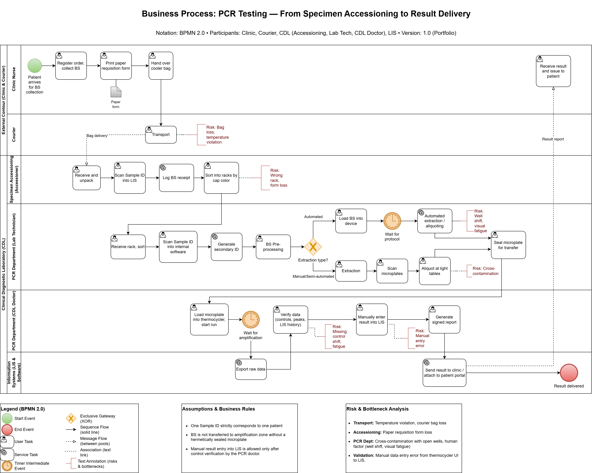

### Text Structure of the "As-Is" Business Process (Prior to New LIS Implementation)

**1. Zone: Collection Site and Courier (External Contour)**
* **Action 1:** Patient registration, biological specimen (BS) collection, printing of the paper requisition form.
* **Action 2:** Courier picks up the cooler bag with manifests and transports it to the laboratory.
* **⚠️ Risks (Bottlenecks):** Registration errors (namesakes, incorrect tests), temperature violations during transit (critical for CSF), loss of the bag or delivery to the wrong address.

**2. Zone: Laboratory Reception (Sorting)**
* **Action 1:** Unpacking bags, prioritization (urgent/distant cities), reconciliation with the manifest.
* **Action 2:** Scanning the primary barcode (Sample ID) into the LIS.
* **Action 3 (Manual):** Sorting tubes into racks by department. The receptionist relies on the paper form and the color of the tube cap.
* **⚠️ Risks:** Loss of the form, loss of the tube, human factor — receptionist placed the tube in the wrong rack (mixed up departments).

**3. Zone: PCR Department — Lab Technician (Clean Zone / Extraction and Aliquoting)**
* **Action 1:** Lab technician retrieves the racks from reception. Inside the department, an additional manual sorting by extraction type (automated/manual) is performed based on codes and cap color.
* **Action 2 (Double work):** Lab technician scans the Sample ID into the internal program ("Analytical Software"). The program assigns a secondary (internal) number to the tube. The patient's full name is not in this program (only on the tube itself).
* **Action 3 (BS Pre-processing):** Centrifugation, as well as the addition of specific reagents for chemical treatment, if strictly required by the preparation methodology for a specific type of biological specimen.
* **Action 4 (Extraction and Aliquoting):** Staging is strictly observed: first BS isolation (extraction), then aliquoting the isolated BS into microplates with dry reagent. Three scenarios are possible:
  * *Scenario A (Automated method):* Lab technician loads all BS, reagents, and plastics into the analyzer station and starts the process. The device fully automatically extracts the BS and aliquots it into the target microplates.
  * *Scenario B (Semi-automated method):* Lab technician places an empty microplate, reagents, and the initial BS into the device. After automated extraction, the lab technician takes the microplate and manually aliquots the BS into microplates with dry reagent using light tables.
  * *Scenario C (Manual method):* Samples are passed through the sorter software. Extraction is done by the lab technician manually (or manual aliquoting into a microplate followed by extraction in the device). Next, the lab technician manually aliquots the extracted BS at the light tables.
* **Action 5 (Double check of aliquoting):** When working at the light tables (scenarios B and C), the lab technician must scan the barcode of each microplate with reagents before aliquoting.
* **Action 6:** Lab technician tightly seals the microplate for transfer to the "dirty" zone.
* **⚠️ Risks:** Cross-contamination of samples, contamination with foreign DNA. During automated aliquoting, "visual fatigue" occurs at the stage of placing tubes in the rack. Incorrect reagents selected.

**4. Zone: PCR Department — CDL Doctor (Dirty Zone / Amplification and Validation)**
* **Action 1:** The doctor places the sealed microplate into the thermocycler and scans the microplate barcode — the program with the required melting temperature is loaded. Amplification is initiated.
* **Action 2:** After amplification is complete, the results (graphs) are automatically exported to the "Analytical Software".
* **Action 3 (Complex verification):** The doctor begins validation. Opens the LIS (age, sex, history) and the "Analytical Software" (checks expiration dates/series of kits, evaluates melting curves, peaks, and controls).
* **Action 4:** If the result is satisfactory, the doctor manually transfers the decision ("Detected / Not detected") from the Analytical Software to the LIS, generating a signed report.
* **⚠️ Risks:** The doctor may miss information about a change in the series of controls/reagents, incorrectly interpret peaks on the curve due to lack of experience, or carelessly make an error during the manual transfer of the result.
