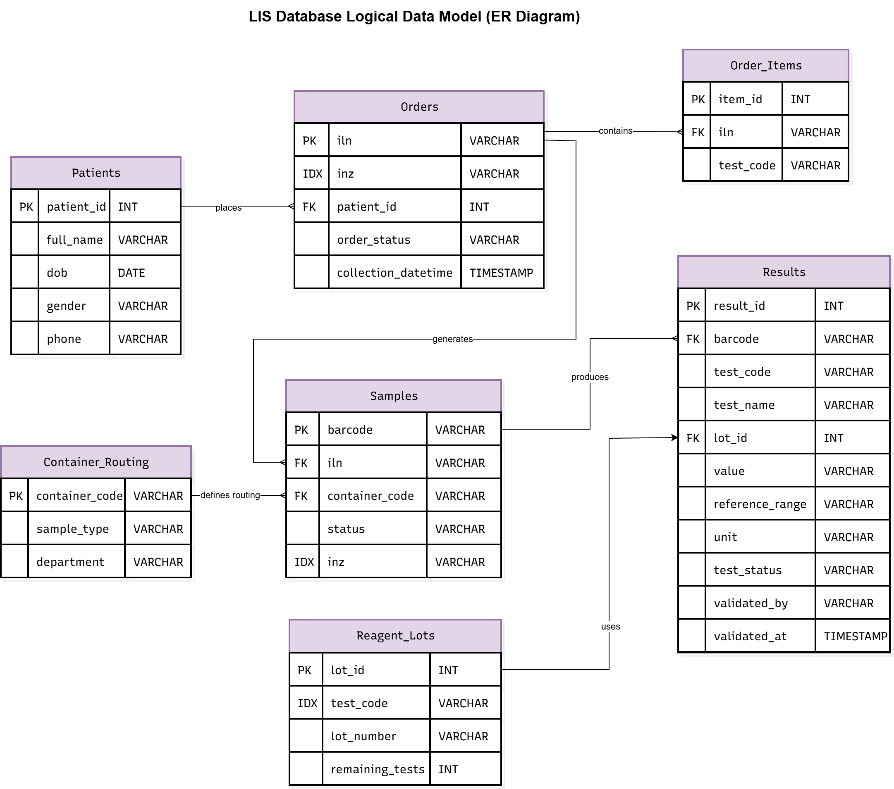

# Архитектура Базы Данных: Лабораторная Информационная Система (ЛИС)

В данном проекте спроектирована логическая модель данных (ER-диаграмма) для маршрутизации и обработки биоматериала, автоматического учета партий реагентов (Lot Tracking) и формирования валидированных результатов в ПЦР/ИФА лаборатории.

## Бизнес-логика: Идентификация, маркировка и безопасность
Основа системы — алгоритм генерации штрихкодов, который автоматизирует маршрутизацию пробирок в нужный отдел и ограничивает доступ к избыточным персональным данным (152-ФЗ / стандарт крупных сетевых лабораторий).

*   **Карточка пациента (`Patients`):** Хранит персональные данные (ФИО, телефон), а также пол и дату рождения, критичные для динамического расчета референсных интервалов.
*   **ИЛН (Идентификационный личный номер / номер заказа):** 12-значный номер (например, `123456789101`), который присваивается конкретному визиту/заказу и печатается на чеке. ИЛН связывает заказ с карточкой пациента и служит ключом при передаче результатов в МИС по API.
*   **ИНЗ (Идентификационный номер заказа):** Общий корень заказа — первые 9 цифр из ИЛН (например, `123456789`).
*   **Код контейнера:** Уникальные 3 цифры (например, `130`), определяющие вид биоматериала и целевой отдел (например, сыворотка для отдела молекулярной диагностики).
*   **Штрихкод биоматериала (на пробирке):** 12-значный код, формируемый по формуле: **ИНЗ + Код контейнера** (например, `123456789130`).
*   **Безопасность и ролевой доступ (RBAC):** Хотя физически на пробирке для удобства процедурной медсестры указывается ФИО и дата забора, в интерфейсе ЛИС лаборант не имеет доступа к таблице `Patients` и работает исключительно со связкой `barcode` (ИНЗ + Код контейнера). Доступ к половозрастным данным и анамнезу открыт только на этапе валидации врачу КДЛ.

---

## Описание сущностей (Таблицы)

### 1. Справочники и Инвентарь

**`Container_Routing`** (Справочник маршрутов)
| Поле | Тип данных | Ключ | Описание |
| :--- | :--- | :--- | :--- |
| `container_code` | VARCHAR(3) | PK | Код контейнера (например, `'130'`) |
| `sample_type` | VARCHAR(50) | — | Тип материала (Сыворотка, Плазма, Мазок) |
| `department` | VARCHAR(100) | — | Целевой отдел (Отдел молекулярной диагностики (ПЦР), ИФА, Общеклинический) |

**`Reagent_Lots`** (Партии реагентов / Lot Tracking)
| Поле | Тип данных | Ключ | Описание |
| :--- | :--- | :--- | :--- |
| `lot_id` | INT | PK | Уникальный ID партии в системе |
| `test_code` | VARCHAR(20) | Index | Код исследования (связь с номенклатурой услуг) |
| `lot_number` | VARCHAR(50) | — | Серия набора реагентов (от производителя) |
| `remaining_tests` | INT | — | Доступный остаток тестов (автоматически списывается при генерации виртуального штатива) |

### 2. Регистратура и Заказы

**`Patients`** (Картотека пациентов)
| Поле | Тип данных | Ключ | Описание |
| :--- | :--- | :--- | :--- |
| `patient_id` | INT | PK | Внутренний ID пациента в БД |
| `full_name` | VARCHAR(100) | — | ФИО пациента |
| `dob` | DATE | — | Дата рождения (используется для расчета возрастных референсов) |
| `gender` | VARCHAR(1) | — | Пол (`M` / `F`; используется для расчета референсов) |
| `phone` | VARCHAR(20) | — | Контактный телефон |

**`Orders`** (Заказы / Визиты)
| Поле | Тип данных | Ключ | Описание |
| :--- | :--- | :--- | :--- |
| `iln` | VARCHAR(12) | PK | ИЛН — уникальный 12-значный номер заказа |
| `inz` | VARCHAR(9) | Index | Корень заказа (первые 9 цифр ИЛН) |
| `patient_id` | INT | FK | Ссылка на карточку пациента (`Patients.patient_id`) |
| `order_status` | VARCHAR(20) | — | Статус заказа (`NEW`, `IN_PROGRESS`, `COMPLETED`) |
| `collection_datetime` | TIMESTAMP | — | Дата и время забора биоматериала (ISO 8601) |

**`Order_Items`** (Назначенные анализы в заказе)
| Поле | Тип данных | Ключ | Описание |
| :--- | :--- | :--- | :--- |
| `item_id` | INT | PK | ID записи |
| `iln` | VARCHAR(12) | FK | Ссылка на заказ (`Orders.iln`) |
| `test_code` | VARCHAR(20) | — | Код медицинской услуги (например, `PCR-COV-19`) |

### 3. Лаборатория (Пробирки и результаты)

**`Samples`** (Физические пробирки)
| Поле | Тип данных | Ключ | Описание |
| :--- | :--- | :--- | :--- |
| `barcode` | VARCHAR(12) | PK | 12-значный штрихкод пробирки (ИНЗ + Код контейнера) |
| `iln` | VARCHAR(12) | FK | Ссылка на заказ (`Orders.iln`) |
| `container_code` | VARCHAR(3) | FK | Ссылка на справочник маршрутов (`Container_Routing.container_code`) |
| `status` | VARCHAR(30) | — | Статус пробирки (`IN_PROGRESS`, `COMPLETED`, `REJECTED`) |
| `inz` | VARCHAR(9) | Index | Корень заказа (денормализовано для быстрого поиска без JOIN) |

**`Results`** (Валидированные результаты)
| Поле | Тип данных | Ключ | Описание |
| :--- | :--- | :--- | :--- |
| `result_id` | INT | PK | Уникальный ID результата |
| `barcode` | VARCHAR(12) | FK | Пробирка, из которой выполнен тест (`Samples.barcode`) |
| `test_code` | VARCHAR(20) | — | Код выполненного исследования |
| `test_name` | VARCHAR(150) | — | Наименование исследования на момент выдачи (фиксация для истории) |
| `lot_id` | INT | FK | Партия реагентов, использованная при постановке (`Reagent_Lots.lot_id`) |
| `value` | VARCHAR(50) | — | Фактический результат (например, `Не обнаружено`) |
| `reference_range` | VARCHAR(100) | — | Динамически рассчитанная норма для данного пациента |
| `unit` | VARCHAR(20) | — | Единица измерения (пустая строка для качественных ПЦР-тестов) |
| `test_status` | VARCHAR(20) | — | Статус теста (`PRELIMINARY`, `VALIDATED`, `REJECTED`) |
| `validated_by` | VARCHAR(100) | — | ФИО врача КДЛ, подтвердившего результат |
| `validated_at` | TIMESTAMP | — | Дата и время валидации результата |

*(Примечание: PK — Primary Key, FK — Foreign Key)*

---

## Примеры работы базы данных (SQL)

### Сценарий 1: Маршрутизация и получение списка тестов по штрихкоду
Лаборант в отделе молекулярной диагностики (ПЦР) сканирует пробирку `123456789130`. Система определяет целевой отдел, тип материала и подтягивает назначенные исследования без доступа к персональным данным пациента.

```sql
SELECT 
    s.barcode,
    c.department,
    c.sample_type,
    oi.test_code
FROM Samples s
JOIN Container_Routing c ON s.container_code = c.container_code
JOIN Orders o ON s.iln = o.iln
JOIN Order_Items oi ON o.iln = oi.iln
WHERE s.barcode = '123456789130';
```

### Сценарий 2: Сборка данных для отправки вебхука в МИС (API)
После того как врач КДЛ валидировал результат, ЛИС собирает полный пакет данных по `iln` заказа (включая данные пациента, отдел и данные валидации) для формирования JSON-запроса в `POST /api/v1/webhook/lab-results`.

```sql
SELECT 
    o.iln,
    o.order_status,
    o.collection_datetime,
    p.full_name,
    p.dob,
    p.gender,
    p.phone,
    c.department,
    r.test_code,
    r.test_name,
    r.test_status,
    r.value,
    r.reference_range,
    r.unit,
    r.validated_by,
    r.validated_at
FROM Orders o
JOIN Patients p ON o.patient_id = p.patient_id
JOIN Samples s ON o.iln = s.iln
JOIN Container_Routing c ON s.container_code = c.container_code
JOIN Results r ON s.barcode = r.barcode
WHERE o.iln = '123456789101'
  AND r.test_status = 'VALIDATED';
```


