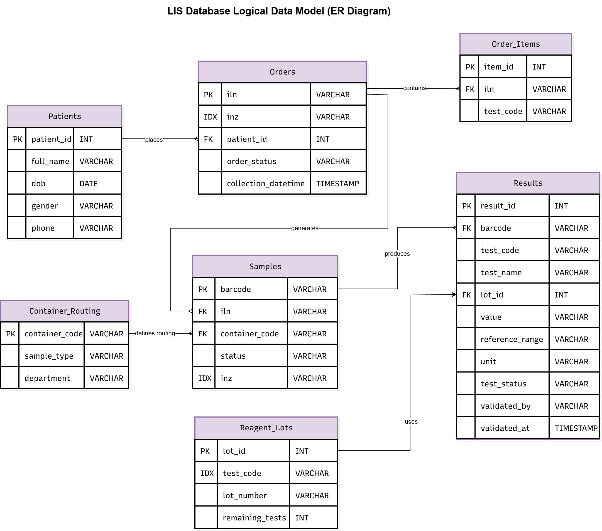

# Database Architecture: Laboratory Information System (LIS)

This project outlines the logical data model (ER diagram) for specimen routing and processing, automated reagent lot tracking, and validated result delivery within a PCR/ELISA laboratory.

## Business Logic: Identification, Labeling, and Security
The core of the system is a barcode generation algorithm that automates specimen routing to the correct department while restricting access to sensitive Protected Health Information (PHI) — a strict standard in large diagnostic networks (HIPAA/GDPR compliance).

*   **Patient Profile (`Patients`):** Stores PHI (full name, phone number) and demographic parameters (gender, date of birth) critical for dynamically calculating reference ranges.
*   **ILN (Order Number):** A 12-digit unique identifier (e.g., `123456789101`) assigned to a specific visit/encounter, printed on the patient's receipt. The ILN links the order to the patient profile and serves as the primary key when transmitting results to the EHR via API.
*   **INZ (Order Root):** The core of the order — the first 9 digits of the ILN (e.g., `123456789`).
*   **Container Code:** A unique 3-digit code (e.g., `130`) defining the specimen type and target department (e.g., serum for Molecular Diagnostics).
*   **Specimen Barcode (on the tube):** A 12-digit code generated using the formula: **INZ + Container Code** (e.g., `123456789130`).
*   **Security & Role-Based Access Control (RBAC):** While the physical tube may contain the patient's name and collection date for the phlebotomist's convenience, the LIS restricts lab technicians from accessing the `Patients` table. Technicians strictly work with the `barcode` (INZ + Container Code). Access to demographic data and clinical history is granted only to the Clinical Pathologist during validation.

---

## Entity Descriptions (Tables)

### 1. Reference Data & Inventory

**`Container_Routing`** (Routing Lookup Table)
| Field | Data Type | Key | Description |
| :--- | :--- | :--- | :--- |
| `container_code` | VARCHAR(3) | PK | Container code (e.g., `'130'`) |
| `sample_type` | VARCHAR(50) | — | Sample type (Serum, Plasma, Swab) |
| `department` | VARCHAR(100) | — | Target department (Molecular Diagnostics (PCR), ELISA, Core Lab) |

**`Reagent_Lots`** (Reagent Lots / Lot Tracking)
| Field | Data Type | Key | Description |
| :--- | :--- | :--- | :--- |
| `lot_id` | INT | PK | Unique lot ID in the system |
| `test_code` | VARCHAR(20) | Index | Test code (linked to the medical service catalog) |
| `lot_number` | VARCHAR(50) | — | Reagent kit lot number (from manufacturer) |
| `remaining_tests` | INT | — | Available remaining tests (automatically deducted upon virtual rack generation) |

### 2. Registration & Orders

**`Patients`** (Patient Registry)
| Field | Data Type | Key | Description |
| :--- | :--- | :--- | :--- |
| `patient_id` | INT | PK | Internal patient ID in the DB |
| `full_name` | VARCHAR(100) | — | Patient's full name |
| `dob` | DATE | — | Date of birth (used for age-specific reference ranges) |
| `gender` | VARCHAR(1) | — | Gender (`M` / `F`; used for reference range calculation) |
| `phone` | VARCHAR(20) | — | Contact phone number |

**`Orders`** (Visits / Encounters)
| Field | Data Type | Key | Description |
| :--- | :--- | :--- | :--- |
| `iln` | VARCHAR(12) | PK | ILN — unique 12-digit order number |
| `inz` | VARCHAR(9) | Index | Order root (first 9 digits of ILN) |
| `patient_id` | INT | FK | Link to the patient profile (`Patients.patient_id`) |
| `order_status` | VARCHAR(20) | — | Order status (`NEW`, `IN_PROGRESS`, `COMPLETED`) |
| `collection_datetime` | TIMESTAMP | — | Specimen collection date and time (ISO 8601) |

**`Order_Items`** (Assigned Tests within the Order)
| Field | Data Type | Key | Description |
| :--- | :--- | :--- | :--- |
| `item_id` | INT | PK | Record ID |
| `iln` | VARCHAR(12) | FK | Link to the order (`Orders.iln`) |
| `test_code` | VARCHAR(20) | — | Medical service/test code (e.g., `PCR-COV-19`) |

### 3. Laboratory (Specimens & Results)

**`Samples`** (Physical Tubes/Specimens)
| Field | Data Type | Key | Description |
| :--- | :--- | :--- | :--- |
| `barcode` | VARCHAR(12) | PK | 12-digit tube barcode (INZ + Container Code) |
| `iln` | VARCHAR(12) | FK | Link to the order (`Orders.iln`) |
| `container_code` | VARCHAR(3) | FK | Link to the routing lookup table (`Container_Routing.container_code`) |
| `status` | VARCHAR(30) | — | Specimen status (`IN_PROGRESS`, `COMPLETED`, `REJECTED`) |
| `inz` | VARCHAR(9) | Index | Order root (denormalized for fast lookups without JOIN) |

**`Results`** (Validated Test Outputs)
| Field | Data Type | Key | Description |
| :--- | :--- | :--- | :--- |
| `result_id` | INT | PK | Unique result ID |
| `barcode` | VARCHAR(12) | FK | Tube used for the test (`Samples.barcode`) |
| `test_code` | VARCHAR(20) | — | Performed test code |
| `test_name` | VARCHAR(150) | — | Test display name at the time of reporting (preserved for audit history) |
| `lot_id` | INT | FK | Reagent lot used for the test (`Reagent_Lots.lot_id`) |
| `value` | VARCHAR(50) | — | Actual test result (e.g., `Not Detected`) |
| `reference_range` | VARCHAR(100) | — | Dynamically calculated reference range for the patient |
| `unit` | VARCHAR(20) | — | Measurement unit (empty string for qualitative PCR assays) |
| `test_status` | VARCHAR(20) | — | Test status (`PRELIMINARY`, `VALIDATED`, `REJECTED`) |
| `validated_by` | VARCHAR(100) | — | Full name of the authorizing Clinical Pathologist |
| `validated_at` | TIMESTAMP | — | Validation timestamp |

*(Note: PK — Primary Key, FK — Foreign Key)*

---

## Database Workflow Examples (SQL)

### Scenario 1: Specimen Routing and Test Lookup by Barcode
A lab technician in the Molecular Diagnostics (PCR) department scans the tube `123456789130`. The system identifies the target department and sample type, and retrieves the list of ordered tests without exposing patient PHI.

```sql
SELECT 
    s.barcode,
    c.department,
    c.sample_type,
    oi.test_code
FROM Samples s
JOIN Container_Routing c ON s.container_code = c.container_code
JOIN Orders o ON s.iln = o.iln
JOIN Order_Items oi ON o.iln = oi.iln
WHERE s.barcode = '123456789130';
```

### Scenario 2: Assembling the Payload for the EHR Webhook (API)
Once the Clinical Pathologist validates the result, the LIS retrieves the complete order payload by `iln` (including patient demographics, department, and validation details) to build the JSON request for `POST /api/v1/webhook/lab-results`.

```sql
SELECT 
    o.iln,
    o.order_status,
    o.collection_datetime,
    p.full_name,
    p.dob,
    p.gender,
    p.phone,
    c.department,
    r.test_code,
    r.test_name,
    r.test_status,
    r.value,
    r.reference_range,
    r.unit,
    r.validated_by,
    r.validated_at
FROM Orders o
JOIN Patients p ON o.patient_id = p.patient_id
JOIN Samples s ON o.iln = s.iln
JOIN Container_Routing c ON s.container_code = c.container_code
JOIN Results r ON s.barcode = r.barcode
WHERE o.iln = '123456789101'
  AND r.test_status = 'VALIDATED';
```


