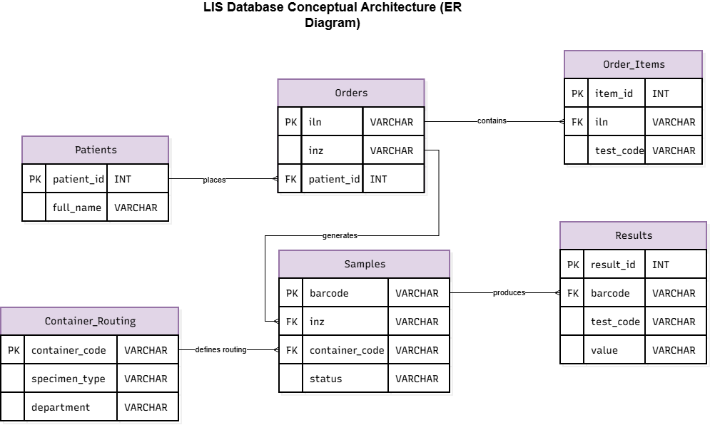

# Database Architecture: Laboratory Information System (LIS)

This project outlines the conceptual database architecture (ER model) for specimen routing and processing within a PCR/ELISA laboratory.

## Business Logic: Identification, Labeling, and Security
The core of the system is a barcode generation algorithm that automates specimen routing to the correct department while restricting access to sensitive Protected Health Information (PHI) — a strict standard in large diagnostic networks (e.g., HIPAA compliance).

*   **Patient Profile:** Stores PHI (e.g., ID/Passport, phone number).
*   **ILN (Order Number):** A 12-digit unique identifier (e.g., `123456789101`) assigned to a specific visit/encounter, printed on the patient's receipt.
*   **INZ (Order Root):** The core of the order — the first 9 digits of the ILN (e.g., `123456789`).
*   **Container Code:** A unique 3-digit code (e.g., `130`) defining the specimen type and routing destination (e.g., serum for PCR Genetics).
*   **Specimen Barcode (on the tube):** A 12-digit code generated using the formula: **INZ + Container Code** (e.g., `123456789130`).
*   **Security & Privacy:** While the physical tube may contain the patient's name and collection date for the phlebotomist's/nurse's convenience, the LIS database restricts lab technicians from accessing the patient's profile. Technicians strictly work with the INZ + Container Code combination, ensuring complete data anonymization during analysis.

---

## Entity Descriptions (Tables)

### 1. Reference & Routing
**`Container_Routing`** (Routing Lookup Table)
| Field | Data Type | Description |
| :--- | :--- | :--- |
| `container_code` | VARCHAR(3) | **[PK]** Container code (e.g., '130') |
| `specimen_type` | VARCHAR(50) | Specimen type (Serum, Plasma, Swab) |
| `department` | VARCHAR(50) | Destination (PCR - Genetics, ELISA, Core Lab) |

### 2. Registration & Orders
**`Patients`** (Client Registry)
| Field | Data Type | Description |
| :--- | :--- | :--- |
| `patient_id` | INT | **[PK]** Internal client ID |
| `full_name` | VARCHAR(100) | Patient's full name |

**`Orders`** (Visits / Encounters)
| Field | Data Type | Description |
| :--- | :--- | :--- |
| `iln` | VARCHAR(12) | **[PK]** ILN — 12-digit order number |
| `inz` | VARCHAR(9) | **[Index]** Order root (first 9 digits of ILN) |
| `patient_id` | INT | **[FK]** Link to the Patient Profile |

**`Order_Items`** (Assigned Tests within the Order)
| Field | Data Type | Description |
| :--- | :--- | :--- |
| `item_id` | INT | **[PK]** Record ID |
| `iln` | VARCHAR(12) | **[FK]** Link to the ILN (Order) |
| `test_code` | VARCHAR(20) | Medical service/test code |

### 3. Laboratory (Specimens & Results)
**`Samples`** (Physical Tubes/Specimens)
| Field | Data Type | Description |
| :--- | :--- | :--- |
| `barcode` | VARCHAR(12)| **[PK]** Tube barcode (INZ + Container Code) |
| `inz` | VARCHAR(9) | **[FK]** Link to the INZ (Order root) |
| `container_code`| VARCHAR(3) | **[FK]** Link to the Routing Lookup Table |
| `status` | VARCHAR(30) | Status (In Progress, Completed, Rejected) |

**`Results`** (Test Outputs)
| Field | Data Type | Description |
| :--- | :--- | :--- |
| `result_id` | INT | **[PK]** Unique result ID |
| `barcode` | VARCHAR(12)| **[FK]** Tube used for the test |
| `test_code` | VARCHAR(20) | Performed test code |
| `value` | VARCHAR(50) | Final test result |

*(Note: [PK] - Primary Key, [FK] - Foreign Key)*

---

## Database Workflow Example (SQL)
*Scenario: A lab technician in the PCR Genetics department scans the tube `123456789130`. The system automatically extracts the last 3 digits (`130`) to determine the specimen type and uses the first 9 digits (`123456789`) to retrieve the required tests from the patient's order, without exposing PHI.*

```sql
SELECT 
    s.barcode,
    c.department,
    c.specimen_type,
    oi.test_code
FROM Samples s
JOIN Container_Routing c ON s.container_code = c.container_code
JOIN Orders o ON s.inz = o.inz
JOIN Order_Items oi ON o.iln = oi.iln
WHERE s.barcode = '123456789130';
```

