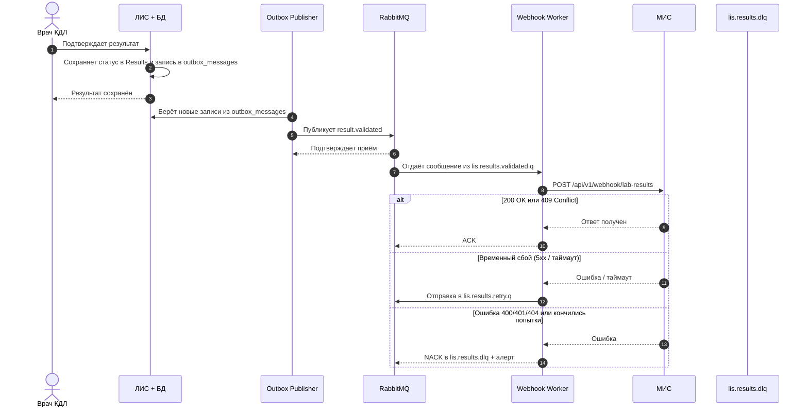

# Интеграция с МИС через брокер сообщений (RabbitMQ)

**Автор:** Ли-Ю-Кун Анна  
**Контур:** РФ и страны СНГ (ЛИС → МИС)  
**Связанные документы:** [Спецификация API результатов](api-results.md) | [OpenAPI схема](api-results-swagger.yaml) | [Модель БД](database.md) | [Сравнение REST и SOAP](../architecture-notes/rest-soap-comparison.md)

---

## Зачем здесь брокер сообщений

Когда врач КДЛ подтверждает результат в ЛИС, этот результат нужно передать в МИС, чтобы он попал в ЭМК пациента. Делать прямой синхронный запрос из ЛИС в МИС в момент сохранения результата рискованно: если МИС недоступна, отвечает долго или отдаёт `5xx`, пользователь в лаборатории не должен ждать или получать ошибку сохранения результата.

Поэтому между валидацией в ЛИС и отправкой вебхука `POST /api/v1/webhook/lab-results` стоит **RabbitMQ** и паттерн **Transactional Outbox**. Это даёт три вещи:
* результат фиксируется в БД ЛИС независимо от состояния внешней МИС;
* при сбоях на стороне МИС или сети сообщения не пропадают и уходят повторно;
* при массовой валидации результатов в пиковые часы нагрузка сглаживается.

---

## Как событие попадает в очередь (Transactional Outbox)

Если сначала сохранить результат в БД, а потом отдельно попытаться отправить сообщение в брокер, при обрыве связи можно получить рассинхрон: результат в ЛИС есть, а в очереди события нет.

Чтобы этого не происходило:
1. Врач КДЛ валидирует результат (`VALIDATED` или `REJECTED`).
2. В одной транзакции БД обновляется статус теста в `Results` и добавляется запись в таблицу `outbox_messages` (со статусом `NEW`).
3. Фоновый процесс (`Outbox Publisher`) забирает записи со статусом `NEW`, публикует их в RabbitMQ и после подтверждения брокера отмечает как `PUBLISHED`.

---

## Очереди и маршрутизация в RabbitMQ

| Элемент | Имя | Зачем нужен |
| :--- | :--- | :--- |
| Exchange | `lis.results.exchange` (`direct`) | Принимает события валидации от `Outbox Publisher`. |
| Основная очередь | `lis.results.validated.q` | Из неё `Webhook Worker` забирает задачи на отправку вебхука в МИС. |
| Routing key | `result.validated` | Направляет событие в основную очередь. |
| Очередь повторов | `lis.results.retry.q` | Держит сообщение паузу перед повторной попыткой при временном сбое, затем возвращает в работу. |
| Очередь ошибок (`DLQ`) | `lis.results.dlq` | Сюда попадают сообщения, которые не удалось доставить после повторов или которые отвалились по ошибке данных/доступа. |

---

## Что лежит в сообщении и как работают заголовки

Формат тела результата соответствует схеме `LabResultPayload` в [api-results-swagger.yaml](api-results-swagger.yaml). Внутренний `lot_id` (партия реагентов для контроля качества внутри ЛИС) во внешний вебхук не передаётся.

```json
{
  "message_id": "550e8400-e29b-41d4-a716-446655440000",
  "event_type": "result.validated",
  "occurred_at": "2026-11-25T10:15:30+03:00",
  "retry_count": 0,
  "payload": {
    "message_id": "550e8400-e29b-41d4-a716-446655440000",
    "iln": "261125000142",
    "order_status": "IN_PROGRESS",
    "results": [
      {
        "test_code": "PCR-COV2-RNA",
        "status": "VALIDATED",
        "value": "Не обнаружено",
        "validated_at": "2026-11-25T10:15:28+03:00"
      }
    ]
  }
}
```

При отправке HTTP-запроса в МИС:
* **`X-Idempotency-Key`** равен `message_id` и **не меняется** при повторных отправках этого же события — так МИС понимает, что это повтор уже полученного пакета, и не плодит дубли в ЭМК.
* **`X-Request-ID`** генерируется заново на каждую попытку отправки, чтобы по логам можно было найти конкретный сетевой вызов.
* Обмен идёт по защищённому каналу (`TLS 1.2+`) с соблюдением требований **152-ФЗ** по работе с персональными данными.

---

## Повторы, подтверждения (`ACK/NACK`) и `DLQ`

Воркер подтверждает обработку сообщения брокеру (`ACK`) только после того, как получит ожидаемый ответ от МИС:

* **`200 OK`** — результат принят, отправляем `ACK`, удаляем из очереди.
* **`409 Conflict`** — МИС сообщает, что такой ключ идемпотентности уже обрабатывался; считаем доставку закрытой, отправляем `ACK`.
* **`5xx` или таймаут** — временная проблема на стороне МИС или сети. Сообщение уходит на повтор через `lis.results.retry.q` с нарастающей задержкой (например, несколько секунд → минуты), пока не исчерпается лимит попыток. Если лимит исчерпан — уходит в `lis.results.dlq`.
* **`400` / `401` / `404`** — ошибка запроса, авторизации или не найден заказ/ИЛН в МИС. Повторять такой запрос без исправления причины нет смысла, поэтому сообщение сразу отправляется в `lis.results.dlq`.

Если сообщение попало в `lis.results.dlq`, поднимается алерт: нужно разобраться, в чём причина (например, не заведён заказ в МИС или протух токен), поправить её и переотправить сообщение с тем же `message_id`.

---

## Схема обмена


