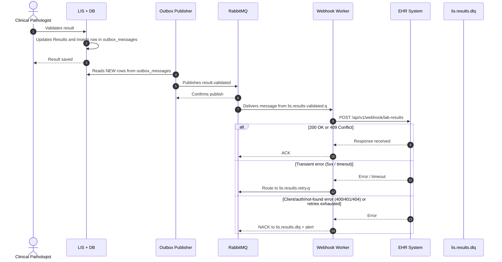

# Message Broker Integration with EHR (RabbitMQ)

**Author:** Li-Iu-Kun Anna  
**Scope:** International (LIS → EHR)  
**Related Docs:** [Results API Specification](api-results_en.md) | [OpenAPI Spec](api-results-swagger_en.yaml) | [Database Schema](database_en.md) | [REST vs. SOAP Comparison](../architecture-notes/rest-soap-comparison_en.md)

---

## Why a Message Broker Is Used Here

When a clinical pathologist validates a test result in the LIS, that result needs to be sent to the EHR so it appears in the patient chart. Sending a direct synchronous request to the EHR right during result validation is risky: if the EHR is down, slow, or returns `5xx`, lab staff should not be stuck waiting or get a save error on the result.

Because of that, **RabbitMQ** and the **Transactional Outbox** pattern sit between validation in the LIS and the `POST /api/v1/webhook/lab-results` call. In practice, this gives three things:
* validation saves in the LIS database regardless of whether the EHR is reachable at that moment;
* transient EHR or network failures do not drop results — retries pick them up;
* bursts of result validation during busy shifts are smoothed out instead of hammering the EHR at once.

---

## How Events Enter the Queue (Transactional Outbox)

If the system saves a result in the database and then separately tries to publish a message to the broker, a brief network drop can leave them out of sync: the result is in the LIS, but the event never reaches the queue.

To prevent that:
1. A clinical pathologist validates a test result (`VALIDATED` or `REJECTED`).
2. Inside **one database transaction**, the LIS updates the test status in `Results` and inserts a row into `outbox_messages` with status `NEW`.
3. A background `Outbox Publisher` reads `NEW` rows, publishes them to RabbitMQ, and marks them `PUBLISHED` once the broker confirms receipt.

---

## RabbitMQ Exchanges, Queues, and Routing

| Component | Name | Role |
| :--- | :--- | :--- |
| Exchange | `lis.results.exchange` (`direct`) | Receives validation events from `Outbox Publisher`. |
| Main queue | `lis.results.validated.q` | Feeds `Webhook Worker` with tasks to send the EHR webhook. |
| Routing key | `result.validated` | Routes validated result events into the main queue. |
| Retry queue | `lis.results.retry.q` | Holds messages for a backoff delay after a transient failure, then routes them back for another try. |
| Dead Letter Queue (`DLQ`) | `lis.results.dlq` | Holds messages that fail after retries or fail due to bad payload/auth/order errors. |

---

## Message Payload and Webhook Headers

The result payload follows the `LabResultPayload` schema in [api-results-swagger_en.yaml](api-results-swagger_en.yaml). The internal `lot_id` (used in the LIS for reagent lot traceability and quality control) is not sent in the outbound webhook.

```json
{
  "message_id": "550e8400-e29b-41d4-a716-446655440000",
  "event_type": "result.validated",
  "occurred_at": "2026-11-25T10:15:30Z",
  "retry_count": 0,
  "payload": {
    "message_id": "550e8400-e29b-41d4-a716-446655440000",
    "iln": "261125000142",
    "order_status": "IN_PROGRESS",
    "results": [
      {
        "test_code": "PCR-COV2-RNA",
        "status": "VALIDATED",
        "value": "Not detected",
        "validated_at": "2026-11-25T10:15:28Z"
      }
    ]
  }
}
```

When sending the HTTP request to the EHR:
* **`X-Idempotency-Key`** equals `message_id` and **stays the same** across all retries of that event — so the EHR recognizes a duplicate delivery and does not create duplicate entries in the patient chart.
* **`X-Request-ID`** is generated fresh for each HTTP attempt so logs can trace a specific network call.
* Traffic runs over `TLS 1.2+` in line with **HIPAA / GDPR** safeguards for protected health and personal data.

---

## Retries, Acknowledgments (`ACK/NACK`), and `DLQ`

The worker sends `ACK` back to RabbitMQ only after getting an expected response from the EHR:

* **`200 OK`** — result accepted; send `ACK` and remove the message from the queue.
* **`409 Conflict`** — EHR reports this idempotency key was already processed; treat delivery as complete and send `ACK`.
* **`5xx` or timeout** — temporary issue on the EHR or network side. Push to `lis.results.retry.q` with increasing delay (for example, seconds to minutes) up to the retry limit; once exhausted, move to `lis.results.dlq`.
* **`400` / `401` / `404`** — invalid payload, auth error, or unknown ILN/order in the EHR. Retrying as-is will not fix it, so send straight to `lis.results.dlq`.

When a message lands in `lis.results.dlq`, an alert fires so someone can check the root cause (such as an unlinked order in the EHR or an expired credential), fix it, and replay the message keeping the original `message_id`.

---

## Delivery Flow


